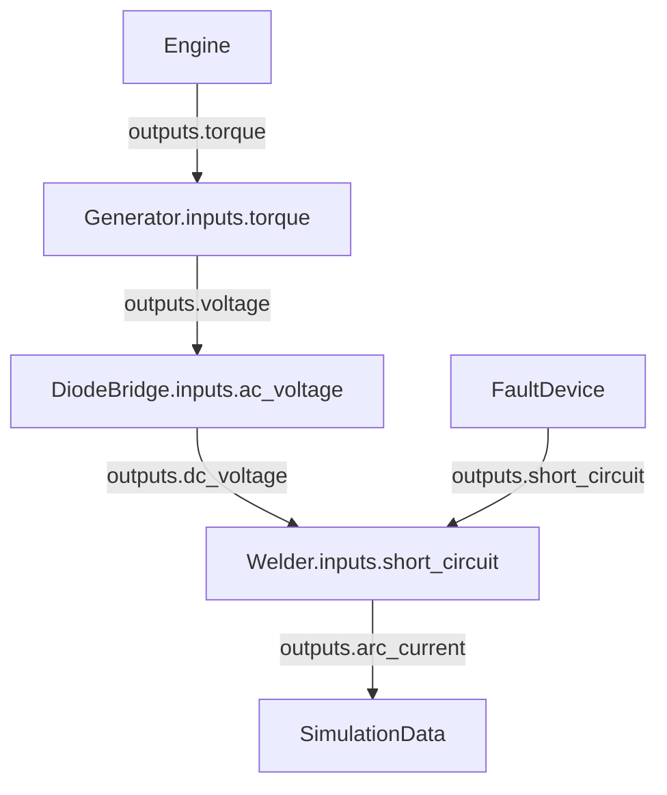

# HANDOFF - StaTable 連携 Phase 2 完了

**日付:** 2026-10-17
**最新コミット:** ccb208a (origin/main)
**次セッション用引き継ぎ資料（統合版）**

---

## 0. このファイルについて

このファイルは次セッションの冒頭で読む **単一の引き継ぎ資料** です。以下を統合しています:

1. **本編**: Phase 2 完了サマリ、ファイル構成、テスト、次期タスク
2. **付録 A**: SPEC_POWERSIM.md（Python シミュレーション設計指示書）
3. **付録 B**: STATABLE_INTEGRATION.md（StaTable 連携仕様書）

次セッションではこのファイルを読むだけで完全なコンテキストを得られます。

---

## 1. 現状サマリ

| 項目 | 状態 |
|---|---|
| Phase 1 実装 | ✅ 完了 |
| Phase 2-A (queue 層間配送) | ✅ 完了 |
| Phase 2-B-1 (ncalc→Python 変換) | ✅ 完了 |
| Phase 2-B-2 (condition/action eval) | ✅ 完了 |
| Phase 2-B-3 (E2E + バッチモード CLI) | ✅ 完了 |
| C# テスト (StaTable) | ✅ 79 件成功 |
| Python テスト (全件) | ✅ 315 件成功 |
| Python テスト (StaTable) | ✅ 50 件成功 |
| E2E (実 XML) | ✅ warnings: 0 で全 assertion pass |
| Git | ✅ origin/main に push 済み |

### コミット履歴（直近 5 件）

```
ccb208a feat(statable): Phase 2-B-3 - batch mode CLI + E2E verification
d8ae834 feat(statable): Phase 2-B-2 - condition/action eval with sandbox
002198a feat(statable): Phase 2-B-1 - ncalc to Python expression converter
fd30e72 feat(statable): Phase 2-A - queue event cross-layer delivery
00fbea3 feat(statable): Phase 1 - StaTable XML integration
```

### 達成したパイプライン（エンドツーエンド）

```
StaTable (外部ツール)
     ↓ design.xml (condition/action 含む)
[StaTableProjectReader]       (C# XML パーサ)
     ↓ StaTableProject モデル
[StaTableCodeGenerator]       (Python コード生成)
[NCalcToPythonConverter]      (ncalc → Python 式変換)
     ↓ controller_box.py (TRANSITIONS に Python 式が埋まる)
[python_runtime.statable]     (Python ランタイム)
     ├─ StaTableControllerBase._evaluate_condition()  ← eval + sandbox
     ├─ StaTableControllerBase._execute_action()      ← exec + sandbox
     └─ StaTableRuntime.tick()                        ← queue 層間配送
     ↓
7 層の状態機械が動作（条件・アクション込み）
```

---

## 2. ファイル構成

### 新規追加（C# 実装）

```
StaTableIntegration/
├── StaTableModel.cs               (データモデル / ~330 行)
├── StaTableProjectReader.cs       (XML パーサ / ~380 行)
├── StaTableCodeGenerator.cs       (コード生成 / ~340 行)
├── NCalcToPythonConverter.cs      (ncalc→Python 変換 / ~200 行) ← Phase 2-B-1
├── StaTableImportForm.cs          (UI フォーム / ~180 行)
└── StaTableImportForm.Designer.cs (UI デザイナ / ~180 行)
```

### 新規追加（C# テスト）

```
PowerSimBuilder.Tests/StaTable/
├── StaTableModelTests.cs             (15 テスト)
├── StaTableProjectReaderTests.cs     (18 テスト)
├── StaTableCodeGeneratorTests.cs     (24 テスト)
└── NCalcToPythonConverterTests.cs    (21 テスト) ← Phase 2-B-1
```

合計 78 テスト（StaTable フィルタで 79 件カウント、既存 1 件含む）

### 新規追加（Python ランタイム）

```
src/python_runtime/statable/
├── __init__.py                    (公開 API)
├── controller_base.py             (StaTableControllerBase / ~260 行)
└── runtime.py                     (StaTableRuntime / ~180 行)
```

### 新規追加（Python テスト）

```
tests/python/
└── test_statable_controller.py    (50 テスト / ~510 行)
```

### 修正ファイル

```
PowerSimBuilder.csproj              (7 ファイル登録)
PowerSimBuilder.Tests.csproj        (4 ファイル登録)
Program.cs                          (バッチモード CLI 追加) ← Phase 2-B-3
.gitattributes                      (改行コード正規化)
.gitignore                          (tmp/ 無視) ← Phase 2-B-3
```

### 生成されるファイル（実行時）

```
<ユーザー指定ディレクトリ>/
└── controller_box.py               (main.py と同じ場所)

バッチモードの場合:
<出力指定パス> (省略時は XML と同じディレクトリに controller_box_powersim.py)
```

---

## 3. セットアップ

### 環境要件

| 項目 | バージョン |
|---|---|
| OS | Windows |
| .NET Framework | 4.7.2 |
| C# LangVersion | latest (実質 C# 7.3 相当) |
| Visual Studio | 2022 Community |
| MSBuild | 17.14.40+ |
| Python | 3.13.7 |
| pytest | 9.1.1 |
| xUnit | 2.9.2 |
| ncalc | 1.3.8（既存参照） |

### 初回セットアップ

```powershell
cd C:\dev\PowerSimBuilder
python -m pip install -e .
```

---

## 4. テスト実行

### C# テスト（StaTable のみ）

```powershell
# 1. ビルド
& "C:\Program Files\Microsoft Visual Studio\2022\Community\MSBuild\Current\Bin\MSBuild.exe" `
    C:\dev\PowerSimBuilder\PowerSimBuilder.sln `
    /p:Configuration=Debug /t:Restore,Build /v:minimal

# 2. テスト
dotnet test C:\dev\PowerSimBuilder\PowerSimBuilder.Tests\PowerSimBuilder.Tests.csproj `
    --no-build --filter "FullyQualifiedName~StaTable" --verbosity minimal
```

**期待:** `合計: 79, 失敗数: 0`

### C# テスト（NCalcToPythonConverter のみ）

```powershell
dotnet test C:\dev\PowerSimBuilder\PowerSimBuilder.Tests\PowerSimBuilder.Tests.csproj `
    --no-build --filter "FullyQualifiedName~NCalcToPythonConverter" --verbosity minimal
```

**期待:** `合計: 21, 失敗数: 0`

### Python テスト（StaTable のみ）

```powershell
cd C:\dev\PowerSimBuilder
python -m pytest tests/python/test_statable_controller.py -v
```

**期待:** `50 passed`

### Python テスト（全件）

```powershell
python -m pytest tests/python -v
```

**期待:** `315 passed`

---

## 5. バッチモード & E2E

### バッチモード CLI（Phase 2-B-3 で追加）

```powershell
& "C:\dev\PowerSimBuilder\bin\Debug\PowerSimBuilder.exe" `
    --statable-import `
    "<xml_path>" `
    "<out.py_path>"
```

**終了コード:**

| コード | 意味 |
|:---:|---|
| 0 | 成功 |
| 1 | XML パースエラー |
| 2 | XML ファイル不在 |
| 3 | その他の例外 |

### GUI モード（後方互換）

```powershell
.\PowerSimBuilder.exe --statable-import
```

### E2E 検証（実 XML での動作確認）

**検証済みの動作（warnings: 0）:**

| # | 検証項目 | 結果 |
|:---:|---|:---:|
| 1 | 7 layers の runtime 構築 | ✅ |
| 2 | condition=False で遷移ブロック | ✅ |
| 3 | condition=True で遷移成功 | ✅ |
| 4 | action 実行（g_counter++） | ✅ |
| 5 | warnings 空 | ✅ |

**サンプル XML の場所:**

```
C:\Users\user\OneDrive\ドキュメント\GitHub\StaTable\dist_package\
  StaTable-CookingHeater-Package-v3.4.3\samples\cooking_heater_controller.xml
```

**注意:** 元 XML の `<Transition>` は condition/action が空。E2E 検証のためには XML DOM で書き換えて注入する必要がある（手順は前セッションのログ参照）。注入スクリプトの骨子:

```powershell
[xml]$doc = [System.IO.File]::ReadAllText($baseXml, $utf8NoBom)
foreach ($tab in $doc.SelectNodes("//Tab")) {
    foreach ($t in $tab.SelectNodes(".//Transition")) {
        if ($t.GetAttribute("source") -eq "InIdle" -and $t.GetAttribute("event") -eq "SENSOR_TICK") {
            $t.SetAttribute("condition", 'g_system_tick > 0')
            $t.SetAttribute("action", 'g_start_count = g_start_count + 1')
        }
    }
}
# ... Save with XmlWriterSettings
```

---

## 6. 実装の要点

### C# 側

| クラス | 役割 |
|---|---|
| `StaTableModel` | XML スキーマの POCO モデル（v2.2〜v3.8 対応） |
| `StaTableProjectReader` | XDocument でパース、SHA256 記録、警告収集 |
| `StaTableCodeGenerator` | Python ソース文字列を生成 |
| `NCalcToPythonConverter` | ncalc 式 → Python 式文字列変換 |
| `StaTableImportForm` | XML 選択→プレビュー→保存ダイアログ |

### Python 側

| クラス / 関数 | 役割 |
|---|---|
| `StaTableControllerBase` | 1 層 (Tab) = 状態機械。`Component` を継承 |
| `_SAFE_BUILTINS` | eval/exec のサンドボックス用 builtins 許可リスト |
| `_evaluate_condition()` | condition 式を eval で評価（エラー時 False） |
| `_execute_action()` | action 式を exec で実行（エラー時 warning のみ） |
| `_bind_runtime()` | runtime から `self.globals` を参照共有 |
| `StaTableRuntime` | 全層を priority 昇順で管理、queue 配送 |
| `StaTableRuntime.enqueue()` | queue イベント投入 |
| `StaTableRuntime.tick()` | 先頭で queue drain → 各層 update |

### 変換テーブル（NCalcToPythonConverter）

| ncalc | Python | 備考 |
|---|---|---|
| `&&` | `and` | 論理積 |
| `||` | `or` | 論理和 |
| `!x` | `not x` | 単項否定（`!=` は除外） |
| `g_xxx` | `self.globals["g_xxx"]` | グローバル変数 |
| `F_xxx(...)` | `self.F_xxx(...)` | RoleFunction 呼び出し |
| `true` / `false` | `True` / `False` | 真偽値 |
| `null` | `None` | null |
| 三項演算子 `a ? b : c` | **未対応** | Phase 2-B' 以降 |

### サンドボックス

```python
_SAFE_BUILTINS = {
    "abs": abs, "min": min, "max": max, "round": round,
    "int": int, "float": float, "bool": bool, "str": str, "len": len,
    "True": True, "False": False, "None": None,
}
# eval/exec 時: {"__builtins__": _SAFE_BUILTINS, "self": self}
# → import / open / __ 系は呼べない
```

### 生成コードの重要マーカー

```python
# STABLE_USER_CODE_START:<Layer>.<Function>
<ユーザー実装>
# STABLE_USER_CODE_END:<Layer>.<Function>
```

→ 再生成時にユーザー実装を保護する仕組み（StaTable 本体と同じ思想）

---

## 7. 既知の制約（バックログ）

### Phase 2-B' で対応予定

| # | 制約 | 対応予定 |
|:---:|---|---|
| 1 | **RoleFunction 未定義時の AttributeError** | ジェネレータが `F_xxx` 参照を抽出し、no-op メソッドを自動生成（Phase 2-B'） |
| 2 | **三項演算子 `a ? b : c` 未対応** | NCalcToPythonConverter に変換追加 |
| 3 | **C++ 構文の `<Action>` 未対応** | `ctx->data.g_system_tick++` 形式は現状スキップ |

### Phase 2-C で対応予定

| # | 制約 | 対応予定 |
|:---:|---|---|
| 4 | **MainForm メニュー未統合** | 通常 GUI から StaTableImportForm を呼び出し |

### Phase 3 以降

| # | 制約 | 対応予定 |
|:---:|---|---|
| 5 | **RoleFunction は no-op スタブ** | ユーザー実装待ち（STABLE_USER_CODE 内） |
| 6 | **queue イベントの action 自動送信** | action 内で `self.queue_event(...)` を自動化 |
| 7 | **v0.3.0 リリース** | Phase 2 をバージョン固定 |

---

## 8. 次のタスク（優先度順）

| # | タスク | 内容 | 優先度 | 工数 |
|:---:|---|---|:---:|:---:|
| **B'** | RoleFunction 動的スタブ | 未定義 `F_xxx` を no-op 化 | 🟡 中 | 1h |
| **C** | MainForm メニュー統合 | 通常 GUI から呼び出し | 🟡 中 | 1h |
| **2-B''** | 三項演算子対応 | `a ? b : c` → Python | 🟢 低 | 30m |
| **3-A** | RoleFunction 本体実装 | STABLE_USER_CODE 展開 | 🔴 高 | 数日 |

### タスク B' の着手方法

1. `StaTableCodeGenerator.WriteLayerClass` で action/condition 文字列をスキャン
2. 正規表現 `\b(F_[A-Za-z0-9_]+)\b` で `F_xxx` を抽出
3. クラス内の `RoleFunctions` に無い `F_xxx` を no-op メソッドとして追加生成
4. テスト追加（`StaTableCodeGeneratorTests.cs`）

### タスク C の着手方法

1. `MainForm.Designer.cs` にメニュー項目追加
2. `MainForm.cs` に `MenuItem.Click` ハンドラ追加
3. `StaTableImportForm` を `ShowDialog()` で呼ぶ

---

## 9. 次セッション開始時のチェックリスト

```powershell
cd C:\dev\PowerSimBuilder

# 1. HEAD の確認（ccb208a が HEAD か）
git log --oneline -5
git status

# 2. editable install 確認
python -m pip install -e .

# 3. C# テスト
& "C:\Program Files\Microsoft Visual Studio\2022\Community\MSBuild\Current\Bin\MSBuild.exe" `
    C:\dev\PowerSimBuilder\PowerSimBuilder.sln `
    /p:Configuration=Debug /t:Restore,Build /v:minimal
dotnet test C:\dev\PowerSimBuilder\PowerSimBuilder.Tests\PowerSimBuilder.Tests.csproj `
    --no-build --filter "FullyQualifiedName~StaTable" --verbosity minimal

# 4. Python テスト
python -m pytest tests/python/test_statable_controller.py -v
```

**期待:**

- HEAD = `ccb208a`
- work tree clean
- C# StaTable テスト 79 件 pass
- Python StaTable テスト 50 件 pass

---

## 10. セッション再開時のプロンプト例

```
StaTable 連携の Phase 2 は完了しました。
HANDOFF_STATABLE.md（統合版）を読んで、
次のタスク（B' / C / 2-B''）から着手してください。

最新コミット: ccb208a
C# テスト: 79 件 / Python テスト: 315 件 すべて pass
E2E: warnings 0 で全 assertion pass

まず着手したいタスクを教えてください。
```

---

## 📚 参考情報

### StaTable リポジトリ

- URL: https://github.com/akashi-hideki/StaTable
- サンプル XML: `dist_package/StaTable-CookingHeater-Package-v3.4.3/samples/cooking_heater_controller.xml`
- 7 層 / 31 状態 / 60 Role 関数

### 主要な仕様書（このファイルの付録）

- **付録 A**: SPEC_POWERSIM.md（Python シミュレーション設計指示書）
- **付録 B**: STATABLE_INTEGRATION.md（StaTable 連携仕様書）

### このセッションで得た教訓

| やること | やらないこと |
|---|---|
| `[System.IO.File]::ReadAllText($p, $utf8NoBom)` | `Get-Content -Raw`（エンコーディング未指定） |
| `[System.IO.File]::WriteAllText($p, $s, $utf8NoBom)` | `Set-Content`（BOM 付き UTF-8 になりがち） |
| 日本語入りファイルは **完全書き直し** | `Read→Replace→Write`（破損リスク高） |
| 長い commit message は **ファイルに書いて `-F`** | `-m "..."` 内に `\"` を書く |
| PowerShell の escape は `` ` `` バッククォート | `\` バックスラッシュ（Windows パス以外では使えない） |

---

## 付録 A: SPEC_POWERSIM.md（Python シミュレーション設計指示書）

以下は元ファイルの内容をそのまま保持。実装状況は本編「1. 現状サマリ」を参照。

---

# Pythonシミュレーション設計指示書（完全版）

## 1. 目的

- 電源、発電機、整流器、溶接機、エンジン、誘導電動機、故障装置の時間シミュレーション
- 共通インタフェースで部品管理：
  - 初期化メソッド (`__init__`)
  - 更新メソッド (`update`)
  - 入力/出力ポート (`inputs`, `outputs`)
- 出力を次の部品入力へ伝搬
- 条件付きシナリオ制御をコンポーネント内部で管理
- JSON/辞書形式で自動生成・VC#ネットリスト変換対応

---

## 2. 共通データ構造

### 2.1 SimulationData（全パラメータ集約）

- 電源・発電機：電圧、電流、周波数、波形
- 整流回路：ダイオード降下、整流方式、リップル、出力電圧
- 溶接機：設定電流、実電流、制御モード、過熱フラグ
- 故障：短絡、開放、突入電流
- 誘導電動機：定格出力、トルク、回転数、すべり
- 全体制御：時間刻み、ログ

### 2.2 Component基底クラス

- ID、タイプ、パラメータ辞書
- inputs, outputs 辞書
- update(t, dt, sim_data) メソッド

```python
class Component:
    def __init__(self, comp_id, comp_type):
        self.id = comp_id
        self.type = comp_type
        self.parameters = {}
        self.inputs = {}
        self.outputs = {}

    def update(self, t, dt, sim_data):
        pass
```

## 3. コンポーネント詳細

| クラス | パラメータ | 入力 | 出力 | 補足 |
| --- | --- | --- | --- | --- |
| PowerSource | voltage, frequency, waveform | - | voltage, current | AC出力 |
| Generator | rated_power, efficiency | torque | voltage, current | 発電機駆動 |
| DiodeBridge | diode_drop, type | ac_voltage | dc_voltage, ripple | 半波/全波/三相 |
| Welder | welding_current_set, mode, overheat_limit | dc_voltage, short_circuit | arc_current, overheat | 定電流/定電圧制御 |
| Engine | power, torque_max | - | torque | 発電機駆動トルク |
| InductionMotor | rated_power, load_torque | voltage | torque, speed, slip | 応答遅れ・負荷トルク |
| FaultDevice | fault_type, condition_expr, duration | - | short_circuit, open_circuit, inrush_current | update内でシナリオ判定・状態管理 |

---

## 4. Connections 原理

- 出力→入力の接続を辞書化・JSON化
- MAIN ループで update 後に伝搬
- FaultDevice も同様に接続反映

### 4.1 Mermaid 図例



### 4.2 JSON形式例

```json
[
  {"from":"engine.outputs.torque","to":"generator.inputs.torque"},
  {"from":"generator.outputs.voltage","to":"bridge.inputs.ac_voltage"},
  {"from":"bridge.outputs.dc_voltage","to":"welder.inputs.dc_voltage"},
  {"from":"fault1.outputs.short_circuit","to":"welder.inputs.short_circuit"}
]
```

---

## 5. FaultDevice 内部シナリオ管理

- condition_expr と duration でトリガー判定
- scenario_state を内部保持
- MAIN ループから状態管理不要

```python
class FaultDevice(Component):
    def __init__(self, comp_id, comp_type):
        super().__init__(comp_id, comp_type)
        self.parameters = {"fault_type":"none","condition_expr":"False","duration":0.0}
        self.outputs = {"short_circuit":False,"open_circuit":False,"inrush_current":0.0}
        self._scenario_state = {"t_start_cond":None,"triggered":False}

    def update(self, t, dt, sim_data):
        cond_result = eval(self.parameters.get("condition_expr","False"))
        if cond_result:
            if self._scenario_state["t_start_cond"] is None:
                self._scenario_state["t_start_cond"] = t
            elif t - self._scenario_state["t_start_cond"] >= self.parameters.get("duration",0):
                if not self._scenario_state["triggered"]:
                    self.outputs["short_circuit"] = True
                    self.outputs["inrush_current"] = self.parameters.get("inrush_current",0.0)
                    self._scenario_state["triggered"] = True
        else:
            self._scenario_state["t_start_cond"] = None
            self._scenario_state["triggered"] = False
```

---

## 6. MAINループ設計

- SimulationData 生成
- Components 登録
- Connections 伝搬
- update → 接続 → ログ収集

```python
def main():
    import numpy as np
    dt = 0.001
    t_end = 5.0
    sim_data = SimulationData()
    sim_data.time_step = dt

    components = {
        "power": PowerSource("power","PowerSource"),
        "generator": Generator("generator","Generator"),
        "bridge": DiodeBridge("bridge","DiodeBridge"),
        "welder": Welder("welder","Welder"),
        "engine": Engine("engine","Engine"),
        "motor": InductionMotor("motor","InductionMotor"),
        "fault1": FaultDevice("fault1","FaultDevice")
    }

    connections = [
        {"from":"engine.outputs.torque","to":"generator.inputs.torque"},
        {"from":"generator.outputs.voltage","to":"bridge.inputs.ac_voltage"},
        {"from":"bridge.outputs.dc_voltage","to":"welder.inputs.dc_voltage"},
        {"from":"fault1.outputs.short_circuit","to":"welder.inputs.short_circuit"}
    ]

    for t in np.arange(0, t_end, dt):
        for comp in components.values():
            comp.update(t, dt, sim_data)

        for conn in connections:
            f_c,f_p = conn["from"].split(".")
            t_c,t_p = conn["to"].split(".")
            components[t_c].inputs[t_p] = components[f_c].outputs[f_p]

        sim_data.logs.append({
            "time": t,
            "components": {cid: {"inputs": comp.inputs.copy(),
                                 "outputs": comp.outputs.copy(),
                                 "parameters": comp.parameters.copy()}
                           for cid, comp in components.items()}
        })
```

---

## 7. VC# ネットリスト変換対応

- Components / Connections を JSON で保持
- FaultDevice の condition_expr も文字列で保持
- 自動生成ツールで scenario_expr 設定
- SPICE形式に変換可能

---

## 付録 B: STATABLE_INTEGRATION.md（StaTable 連携仕様書）

**注記（2026-10-17 追記）:** 以下の元仕様書は「実装（将来対応）」として書かれていますが、Phase 2 完了時点で **全モジュール実装済み・テスト通過・E2E 検証済み** です。実装状況は本編「1. 現状サマリ」を参照してください。なお、`StaTableCodeGenerator.cs` には Phase 2-B-1 で `NCalcToPythonConverter.cs` の呼び出しが追加されています。

---

以下は元ファイルの内容をそのまま保持。

---

# StaTable 連携仕様書

## 目的
StaTable（独立ツール）で設計した状態機械 XML を
PowerSimBuilder に取り込み、Python 制御ボックスコードを自動生成する。

## ステータス
- [x] 設計完了
- [x] 実装（Phase 1 + Phase 2 完了: 2026-10-17）
  - Phase 1: 基本パイプライン（XML 読込 → Python 生成 → 実行）
  - Phase 2-A: queue イベント層間配送
  - Phase 2-B-1: ncalc → Python 式変換
  - Phase 2-B-2: condition / action の eval / exec（サンドボックス）
  - Phase 2-B-3: E2E 検証 + バッチモード CLI

## アーキテクチャ
StaTable (独立) → design.xml → PowerSimBuilder → controller_box.py

## 追加モジュール（実装済み）
- StaTableIntegration/StaTableModel.cs
- StaTableIntegration/StaTableProjectReader.cs
- StaTableIntegration/StaTableCodeGenerator.cs
- StaTableIntegration/NCalcToPythonConverter.cs（Phase 2-B-1 で追加）
- StaTableIntegration/PythonCodeTemplates.cs（現状は StaTableCodeGenerator 内に統合）
- StaTableIntegration/StaTableImportForm.cs

## 詳細
（前回提示した設計内容をここに貼り付け）

---

**End of HANDOFF**


---

# Phase 2 拡張 + Phase 3 準備（2026-10-17 追記）

**HEAD:** `963ee8a` (origin/main)

## 11. 本セッションの完了タスク

| # | タスク | コミット | 内容 |
|:---:|---|---|---|
| **B'** | RoleFunction 動的スタブ | `1f39047` | 未定義 `F_xxx` を no-op スタブ自動生成（B'） |
| **2-B''** | 三項演算子対応 | `52ba7a6` | `a ? b : c` → `(b if a else c)` |
| **B''-prefix** | `F_` プレフィックス正規化 | `9f2b73a` | `RoleFunctions.Name` に `F_` を自動付与 |
| **C** | MainForm 統合 | `d4913c4` | ツールバーに「StaTable取込」ボタン追加 |
| **案 A** | ファイルダイアログ | `963ee8a` | 読み込み/保存に `OpenFileDialog` / `SaveFileDialog` |

## 12. テスト状況

| スコープ | 件数 | 状態 |
|---|---:|---|
| C# `StaTable` 全体 | **94** | ✅ pass |
| C# `NCalcToPythonConverter` | 29 | ✅ pass |
| C# `StaTableCodeGenerator` | 32 | ✅ pass |
| Python 全体 | 315 | ✅ pass |
| Python `StaTable` | 50 | ✅ pass |

## 13. E2E 検証結果

| タスク | 検証内容 | 結果 |
|---|---|:---:|
| B' | 実 XML に `F_undefined_test()` を注入 → スタブ生成確認 | ✅ |
| 2-B'' | 三項演算子 + 未定義 `F_xxx` の連携確認 | ✅ |
| B''-prefix | 実 XML の RoleFunction を `F_` 付きで参照 → 定義と参照の一致確認 | ✅ |

## 14. 実装の追加ポイント

### 三項演算子変換（`NCalcToPythonConverter.cs`）

| ncalc | Python |
|---|---|
| `a ? b : c` | `(b if a else c)` |
| `a ? b : c ? d : e` | `(b if a else (d if c else e))`（右結合） |
| `(a ? b : c) > 0` | `(b if a else c) > 0` |

- 実装: `ConvertTernary` / `FindTopLevelQuestionMark` / `FindMatchingColon` / `RecurseIntoParens` / `IsBalancedParens`
- `ConvertCore` のステップ 7 に挿入

### `F_` プレフィックス正規化（`StaTableCodeGenerator.cs`）

- `NormalizeRoleFunctionName(string)`: `F_` が無ければ付与、既に付いていれば二重付与しない
- `WriteRoleFunction`: 正規化名で `def F_xxx(self):` を出力
- `CollectMissingRoleFunctions`: `defined` 集合も正規化して比較（B' のスタブ二重生成防止）

### B' のスタブ生成（`StaTableCodeGenerator.cs`）

- 未定義 `F_xxx` を Ordinal 昇順で no-op スタブ化
- シグネチャ: `(self, *args, **kwargs)`（引数不一致による `TypeError` 防止）
- 戻り値: `return 0`（`None` 比較による `TypeError` 防止）
- `STABLE_USER_CODE_START/END` で再生成時のユーザー実装保護

## 15. 既知の制約（更新版）

### Phase 3 以降

| # | 制約 | 対応予定 |
|:---:|---|---|
| 1 | **RoleFunction は no-op スタブ** | Phase 3-A でユーザー実装（`STABLE_USER_CODE` 内） |
| 2 | **別レイヤーの `F_xxx` 参照は no-op** | `B''-warn`（警告追加、優先度 🟢 低） |
| 3 | **裸の RoleFunction 名（`F_` なし）は変換されない** | `B''-bare`（自動変換/警告、優先度 🟢 低） |
| 4 | **queue イベントの action 自動送信** | action 内で `self.queue_event(...)` を自動化 |
| 5 | **v0.3.0 リリース** | Phase 2 をバージョン固定 |

## 16. 次のタスク（優先度順）

| # | タスク | 内容 | 優先度 | 工数 |
|:---:|---|---|:---:|:---:|
| **3-A** | RoleFunction 本体実装 | `STABLE_USER_CODE` 展開（120 関数） | 🔴 高 | 数日 |
| **B''-warn** | 別レイヤー参照の警告 | レイヤー跨ぎの `F_xxx` を警告 | 🟢 低 | 30m |
| **B''-bare** | 裸の RoleFunction 名の検出 | `F_` なし参照の自動変換/警告 | 🟢 低 | 30m |
| **v0.3.0** | リリース | Phase 2 のバージョン固定 | 🟡 中 | 1h |

## 17. 本セッションの教訓

### PowerShell の罠

| やること | やらないこと |
|---|---|
| `Write-Host ("..." -f $x) -ForegroundColor Green` のように `-f` を括弧で囲む | `Write-Host "..." -f $x -ForegroundColor Green`（`-ForegroundColor` が `-f` に吸い込まれる） |
| `[regex]::Escape()` でリテラル化してから `-match` | 生の `()` を `-match` に埋め込む（メタ文字事故） |
| 複数行スクリプトは `function` でラップ | 一括貼り付けで `throw` に頼る（後続行が実行される） |
| 生成コード内の文字列は `Contains()` でリテラル比較 | エスケープ済み/未エスケープの混同（`\"` vs `"`） |
| E2E はファイル可視性リトライ（最大 5 秒）を入れる | CLI 直後の `Test-Path` 1 回で判断（false negative あり） |

### WinForms の罠

| やること | やらないこと |
|---|---|
| `ToolStripButton` の `new` は `toolStrip1.Items.AddRange` の**前** | プロパティ設定エリアで `new`（AddRange 時に null でクラッシュ） |
| EXE ロック時はプロセス終了 → 解放待ち（リトライ） | ロックしたままビルド（`MSB3026`/`MSB3027`） |

### 設計上の知見

| 知見 | 内容 |
|---|---|
| **StaTable の RoleFunction はレイヤー単位** | 別レイヤーの `F_xxx` は同一クラスから呼べない → B' が no-op スタブで安全に吸収 |
| **`F_` プレフィックスは呼び出し規約** | XML の `RoleFunctions.Name` は `F_` なしでも、生成コード側で正規化する |
| **ファイルダイアログの導入** | 固定パス `system.json` はユーザビリティが低い。標準ダイアログで任意パス対応 |

---

**End of Session Append**

---

# Task 3-A 完了（2026-10-17 追記）

**HEAD:** `7c96489` (origin/main)

## 18. 3-A で完了したタスク

| # | タスク | コミット | 内容 |
|:---:|---|---|---|
| **3-0** | STABLE_USER_CODE 保存機構 | `20e0b41` | マーカー内ユーザー実装を再生成時に保持 |
| **3-A-1** | DriverInput 6 関数 | `ba99ae1` | センサー EMA / queue_event / ドア安全停止 |
| **3-A-2-A** | DriverOutput 13 関数 | `a7f974c` | ヒータ / ファン / ポンプ / マグネトロン制御 |
| **3-A-2-B** | Application 10 関数 | `0198bdd` | シーケンス制御 / エラー管理 |
| **3-A-3** | Mw* 4 層 31 関数 | `7c96489` | MwMicrowave / MwGrill / MwOven / MwSteam |

**合計: 60 / 60 関数実装完了**

## 19. 実装内容の要点

### グローバル変数マッピング

| 変数 | 用途 | 使用層 |
|---|---|---|
| `g_system_tick` | 決定的疑似ノイズ生成 | DriverInput, MwOven, MwSteam |
| `error_code` | エラーコード（0xE1=MW, 0xE2=GR, 0xE3=OV, 0xE4=ST） | 全層 |
| `heater_*_on/duty` | ヒータ制御 | DriverOutput, MwGrill, MwOven, MwSteam |
| `fan_on/duty` | ファン制御 | DriverOutput, MwOven |
| `pump_on/pulse_count` | ポンプ制御 | DriverOutput, MwSteam |
| `mag_on/mw_power/mw_target_power` | マグネトロン | DriverOutput, MwMicrowave |
| `seq_step/seq_total/stage_*` | シーケンス制御 | Application |
| `door_open` | 安全フラグ | DriverInput |

### 設計パターン

- **決定的シミュレーション**: `g_system_tick` からノイズを生成（乱数不使用、再現性確保）
- **エラーコード方式**: `LogXxxFault` は既存 `error_code` を保持、`ClearXxxFault` は該当コードのみクリア
- **`_on` と `_duty` の同期**: `SetXxxPwm` は `duty > 0` → `on = 1` の規則
- **PID 制御**: `CalculateSteamPID` は P 制御（gain=1、clamp 0..100）

### エラーコード

| コード | 層 | 意味 |
|---|---|---|
| `0xE1` | MwMicrowave | マグネトロン故障 |
| `0xE2` | MwGrill | グリル故障 |
| `0xE3` | MwOven | オーブン故障 |
| `0xE4` | MwSteam | スチーム故障 |

## 20. テスト状況

| スコープ | 件数 | 状態 |
|---|---:|---|
| C# StaTable 全体 | 94 | ✅ pass |
| DriverInput 直接呼び出し | 6 | ✅ pass |
| DriverOutput 直接呼び出し | 13 | ✅ pass |
| Application 直接呼び出し | 10 | ✅ pass |
| Mw* 4 層直接呼び出し | 31 | ✅ pass |
| 回帰（3 層連携） | 3 | ✅ pass |

## 21. 残タスク

| # | タスク | 内容 | 優先度 |
|:---:|---|---|:---:|
| **3-B** | 統合動作確認 | 7 層 tick ベースのシナリオテスト | 🟡 中 |
| **v0.3.0** | リリース | Phase 2 + 3-A のバージョン固定 | 🟡 中 |
| **B''-warn** | 別レイヤー参照警告 | レイヤー跨ぎ `F_xxx` の警告 | 🟢 低 |
| **B''-bare** | 裸 RoleFunction 名検出 | `F_` なし参照の自動変換 | 🟢 低 |

## 22. 本セッション（3-A）の教訓

### pre-commit `mixed-line-ending` 対策

**問題**: 生成コードが CRLF を含むため、コミットのたびに `mixed-line-ending` が発動し、2 回コミットが必要。

**対策**:
- コミット前に `.Replace("
", "
")` で LF 正規化
- 次回以降は `StaTableCodeGenerator.GenerateToFile` で `\n` 出力に統一するか、`.gitattributes` で `generated/*.py text eol=lf` を指定

### PowerShell の罠

| やること | やらないこと |
|---|---|
| `git commit -m "..."` を直接使う（短いメッセージ） | ヒアドキュメント `@'...'@`（Ctrl+C で中断リスク） |
| 長いメッセージは `feat(statable): implement Mw* RoleFunctions (Task 3-A-3)

MwMicrowave (6) / MwGrill (6) / MwOven (10) / MwSteam (9) = 31 関数を実装。

実装:
- MwMicrowave: magnetron 制御 + anode 電流監視
- MwGrill: グリルヒーター制御 + 過熱判定
- MwOven: PID bit 制御 + 3 ヒータ duty + ファン + サーミスタ読み取り + 過熱判定
- MwSteam: ボイラーヒーター + ポンプパルス + 温度読み取り + P 制御 PID + 過熱判定

エラーコード: 0xE1 (MW) / 0xE2 (GR) / 0xE3 (OV) / 0xE4 (ST)

Tests: 31 関数 + 3 層回帰 PASS = "..."` + `git commit -m feat(statable): implement Mw* RoleFunctions (Task 3-A-3)

MwMicrowave (6) / MwGrill (6) / MwOven (10) / MwSteam (9) = 31 関数を実装。

実装:
- MwMicrowave: magnetron 制御 + anode 電流監視
- MwGrill: グリルヒーター制御 + 過熱判定
- MwOven: PID bit 制御 + 3 ヒータ duty + ファン + サーミスタ読み取り + 過熱判定
- MwSteam: ボイラーヒーター + ポンプパルス + 温度読み取り + P 制御 PID + 過熱判定

エラーコード: 0xE1 (MW) / 0xE2 (GR) / 0xE3 (OV) / 0xE4 (ST)

Tests: 31 関数 + 3 層回帰 PASS` | 配列 `@(...)` + `WriteAllText`（pre-commit 修正で再実行が必要） |
| `function` 定義 + 実行行をセットで貼る | 説明文・期待結果の例を混ぜて貼る |

### 実装上の知見

- **層ごとの独立性**: DriverOutput / Mw* は機械的、Application はシーケンス制御
- **エラーコード方式**: 既存保持 + 該当コードのみクリアで、層間の独立性を確保
- **決定的シミュレーション**: `g_system_tick` ベースの擬似ノイズで再現性確保

---

**End of Task 3-A**

---

# Task 3-C 完了（2026-10-17 追記）

**HEAD:** `ab403ae` (origin/main)

## 23. Task 3-C 完了タスク

| # | タスク | コミット | 内容 |
|:---:|---|---|---|
| **3-C-1/2** | ControllerBox Component + Palette | `e5d378b` | StaTableRuntime の Component ラップ |
| **3-C-2補** | Palette UI 調整 | `4c9a4ee` | アイコン/幅/フォント改善 |
| **3-C-3** | 遅延ロード | `66299d8` | update() 時にランタイムロード |
| **3-C-4** | E2E デモ | `e2b6a4b` | auto_events + XML action 注入 |
| **3-C-6** | 動的 Descriptor | `ab403ae` | プロジェクト固有ポート導出 |

## 24. 動作確認済み機能

- StaTable XML 取り込み → パレットにプロジェクト名で自動追加
- .py から入出力ポートを自動導出（read/write 判定）
- 複数 XML の共存（別プロジェクトとして独立）
- 同一プロジェクトの複数配置は自動採番（`_2`, `_3`...）
- 未取り込み時はパレット非表示（静的エントリ削除）
- E2E デモ: 過熱検出（T=250.3°C, err=0xE3）+ ドア安全停止

## 25. 既知の制約

### 3-D で対応: sensor 変数の上書き問題

`F_ReadSensorsMovingAvg` が `thermistor_*` を擬似ノイズで上書きするため、
Canvas で `HeaterBlock.temperature → ControllerBox.thermistor_top` と
接続しても上書きされる。

対処案: simulation_mode フラグで擬似ノイズを無効化、または書き込み削除。

### 3-C-7 で対応: 保存先の自動提案

保存先が `controller_box.py`（固定）→ `tmp/` に保存される事故。
初期ファイル名を `<ProjectName>_controller.py`、初期ディレクトリを
`generated/` に変更。

### 3-C-8 で対応: Canvas 経由の E2E

`createSimButton` → `main.py` 生成 → 実行の完全フローは未検証。
`PythonSimulationMainBuilder` が `auto_events` を生成しない問題も要対応。

## 26. 残タスク

| # | タスク | 優先度 |
|:---:|---|:---:|
| 3-C-7 | 保存先の自動提案 | 🟡 中 |
| 3-C-8 | Canvas GUI 経由の E2E | 🟡 中 |
| 3-D | F_ReadSensorsMovingAvg 修正 | 🟡 中 |
| 3-E | シナリオデータ整備 | 🟡 中 |
| B'-warn | 別レイヤー参照警告 | 🟢 低 |
| B'-bare | 裸 RoleFunction 名検出 | 🟢 低 |
| v0.4.0 | 次期リリース | 🟡 中 |

## 27. 本セッション（3-C）の教訓

### PowerShell

- `Read-LfText` / `Save-LfText` ヘルパーで CRLF/LF を統一
- 行ベースの状態機械で C# ファイルを編集（複雑な正規表現は括弧を壊す）
- 編集前に `Copy-Item` でバックアップ

### C# コード生成

- C# では `Console.WriteLine` / `LogcatTraceHelper` を使う（Write-Host 混入禁止）
- C# の逐語的文字列（ダブルクォート2つ）は PowerShell では扱いが異なる
- シングルクォート文字列の中にシングルクォートを書かない

### 動的 Descriptor 設計

- α 案（プロジェクト単位）が正解。β 案（単一）は実装・UX で劣る
- 静的エントリは完全削除（未取り込み時非表示）
- 自動採番は既存 `DesignCanvas.GenerateUniqueInstanceName` を活用

---

**End of Task 3-C**

---

# Task 3-C 完全完了（2026-10-17 追記）

**HEAD:** `0c57d57` (origin/main)

## 28. 本セッション完了タスク

| # | タスク | コミット | 内容 |
|:---:|---|---|---|
| **3-C-7c** | ポート座標統一 + 二重発火修正 | `853079b` | 3箇所の座標式を統一 |
| **3-C-8** | GUI 経由 main.py 生成修正 | `c15fe08` | ComponentInstances + 実パラメータ |
| **chore** | Program.DBG + debug.log ignore | `6e932b8` | ファイルベースデバッグログ |
| **chore** | E2E テスト用ファイル ignore | `0c57d57` | generated/ の E2E 残骸除外 |
| **3-D** | thermistor 上書き修正 | `011893e` | sensor 変数の read-only 化 |

## 29. 動作確認済み（E2E）

### GUI 経由フルパイプライン

1. Canvas で 3 コンポーネント配置（CookingHeaterController + HeaterBlock + Gain）
2. 3 接続（heater_top_duty → gain → voltage → temperature → thermistor_top）
3. 保存 → demo_system.json
4. createSimButton → PythonSimulationMainBuilder → demo_main.py 生成
5. main.py 実行

| シナリオ | 結果 |
|---|---|
| t_end=5.0s | T=120.15°C, duty=100, err=0x00  PASS |
| t_end=20.0s | T=354.67°C, duty=100, err=0xE3  PASS（過熱検出） |

### 主要バグ修正

- ポート座標が 3 箇所で不一致（描画 vs クリック判定 vs 線端点）
- 1 クリックで PortClicked が 2 回発火（MouseDown + OnMouseDown）
- main.py のコンポーネント ID が Descriptor.Name（Connection の InstanceName と不一致）
- main.py のパラメータが Descriptor.Parameters の DefaultValue（system.json の実値が無視）
- 数値パラメータが文字列化（"50"）、None パラメータも出力

## 30. 残タスク

| # | タスク | 内容 | 優先度 |
|:---:|---|---|:---:|
| **3-C-9** | ParametersEditorForm | PropertyGrid で Dictionary 編集不可の UX 改善 | 🟡 中 |
| **3-E** | シナリオデータ整備 | 実機仕様ベースのシナリオ | 🟡 中 |
| **v0.4.0** | リリース | 3-C 完了をバージョン固定 | 🟡 中 |
| B'-warn | 別レイヤー参照警告 | 低優先 | 🟢 低 |
| B'-bare | 裸 RoleFunction 名検出 | 低優先 | 🟢 低 |

## 31. 本セッションの教訓

### PowerShell

- **`\"` は無効**: PowerShell のダブルクォート内でバックスラッシュエスケープ不可。
  メッセージ作成は必ず `@'...'@` (シングルクォート here-string) で行う
- `.Replace(anchor, @'...'@ -replace ...)` は 3 引数と誤解される。
  必ず `$old = @'...'@; $new = @'...'@; $s.Replace($old, $new)` の 3 行形式
- `$LASTEXITCODE` チェックは「既にコミット済み」でも誤発火するため、
  `git log` で結果確認するのが安全

### C# 生成コード

- `System.Text.Json` の `object` は `JsonElement` になる。
  `is double` / `is string` ではマッチしない。`JsonElement.ValueKind` で分岐
- `null` パラメータは出力しない（`__init__` デフォルト保持）
- numeric-string（"50"）は数値に強制変換

### 設計

- `Components`（List<ComponentDescriptor>）は型情報用に残し、
  実行時情報は `ComponentInstances`（List<ComponentControl>）で別管理
- これにより既存メソッド（NeedsDateTimeImport 等）を壊さず段階的に移行可能

---

**End of Task 3-C (Complete)**

---

# Task 3-E 完了（2026-10-17 追記）

**HEAD:** f57ee8e + 3-E 作業コミット

## 28. 3-E 完了タスク

| # | タスク | 内容 |
|:---:|---|---|
| **3-E-1** | scenarios 組織化 | cooking_heater の 3 ファイルを `tests/data/scenarios/` へ `git mv` |
| **3-E-2** | 新規シナリオ 2 本 | `motor_drive`（PWM3Phase+Inertia）/ `heater_overheat`（TPS+Heater+OCD） |
| **3-E-3** | pytest E2E 4 本 | 各シナリオの system.json と cooking_heater の design.xml を実行検証 |
| **3-E-4** | auto-discovery 拡張 | `_resolve_generated_path` に scenarios 候補追加 |

## 29. ディレクトリ構造

```
tests/data/scenarios/
├── README.md
├── cooking_heater/
│   ├── design.xml                   (← generated/cooking_heater_demo.xml)
│   ├── controller_box.py            (← generated/controller_box_powersim.py)
│   ├── controller_box_demo.py       (← generated/controller_box_powersim_demo.py)
│   └── README.md
├── motor_drive/
│   ├── system.json                  (新規)
│   └── README.md
└── heater_overheat/
    ├── system.json                  (新規)
    └── README.md
```

## 30. テスト状況

| スコープ | 件数 | 状態 |
|---|---:|---|
| pytest 全件 | 319+ | ✅ pass（SKIP なし） |
| 新規シナリオテスト | 4 | ✅ pass |
| controller_box 系 | 13 | ✅ pass（SKIP → pass 復活） |

## 31. 教訓

### here-string の貼り付け罠

PowerShell セッションへの貼り付け経路で、``` ``` ``` 連続行を含む `@"..."@` / `@'@` が崩れることがある。
**対策:** 複数行ファイル作成は `@(line1, line2, ...) -join "`n"` 方式で書く（バッククォート不使用）。

### auto-discovery の波及

`generated/` からファイルを移動すると、auto-discovery に頼っている既存テストが連鎖的に `FileNotFoundError` になる。
**対策:** `_resolve_generated_path` に新パスを候補として追加し、後方互換を維持。

### ControllerBox の auto_events

`controller_box.py`（素の生成物）は XML `<Action>` が空だと duty=0 のまま。
**対策:** `controller_box_demo.py` + `parameters["auto_events"]="demo_oven"` の両方が必要。

## 32. 次のタスク

| # | タスク | 優先度 |
|:---:|---|:---:|
| **3-F** | SPEC_POWERSIM 7 コンポーネント実装（PowerSource/Generator/DiodeBridge/Welder/Engine/InductionMotor/FaultDevice） | 🟡 中 |
| **i18n** | 英語/中国語対応（リソースファイル化） | 🟢 低 |
| **v0.4.1** | 3-E のバージョン固定 | 🟡 中 |
| **B'-warn / B'-bare** | 低優先 | 🟢 低 |

## 33. Task 3-F の概要（新規）

**目的:** SPEC_POWERSIM §3 の 7 コンポーネントを Python に実装する。

**入力:** 各コンポーネントのパラメータ・IO 仕様（HANDOFF 付録 A §3）

**実装対象:**
- PowerSource（AC 電圧源）
- Generator（発電機、Engine からトルク入力）
- DiodeBridge（整流器）
- Welder（溶接機、短絡/定電流モード）
- Engine（エンジン、トルク出力）
- InductionMotor（誘導電動機、すべり制御）
- FaultDevice（故障装置、condition_expr + duration）

**工数:** 4-6h

**テスト方針:** 各コンポーネントの単体テスト + `tests/data/scenarios/welder_fault/` の新規シナリオ

**End of Task 3-E**

---

# セッション末ハンドオーバー（2026-10-17 第 3 セッション）

**HEAD:** `e1e292e` (origin/main)
**次セッションの起点:** `e1e292e`

> **次セッションは ## 34-39（本セクション）と ## 28-33（Task 3-E 完了）を読めば完全なコンテキストを得られる。**

## 34. 本セッションの完了タスク

| # | タスク | コミット | 内容 |
|:---:|---|---|---|
| 1 | **v0.4.0 リリース** | `f77545a` | Phase 3-C 完了のバージョン固定 |
| 2 | **3-C-9-a: ParameterTypeHelper** | `f57ee8e` | 型判定を独立ヘルパに抽出 + 空/未知 Type の型推論 |
| 3 | **3-E: シナリオデータ整備** | `e1e292e` | `tests/data/scenarios/` へ外部化 + 新規 2 シナリオ |

## 35. 現在のテスト状況（`e1e292e` 時点）

| スコープ | 件数 | 状態 |
|---|---:|---|
| C# StaTable | 94 | pass |
| C# ParameterTypeHelper | 60 | pass |
| Python 全件 | 319+ | pass（SKIP なし） |
| Python 新規シナリオ | 4 | pass |

## 36. 次セッションの着手推奨手順

### Step 0: 状態確認

    cd C:\dev\PowerSimBuilder
    git --no-pager log --oneline -3      # e1e292e が HEAD か確認
    git status --porcelain=v1            # clean か確認
    python -m pytest tests/python -q     # 319+ pass か確認

### Step 1: v0.4.1 リリース（推奨・約 1h）

**理由:** 3-C-9-a + 3-E の 2 コミットが積み上がっている。
3-F（4-6h の大タスク）に着手する前にリリースポイントを作る。

1. `pyproject.toml`: 0.4.0 -> 0.4.1
2. `VERSION`: 0.4.0 -> 0.4.1
3. `CHANGELOG.md`: `[0.4.1] - 2026-10-17` セクション追加
4. コミット `chore: release v0.4.1`
5. annotated タグ `v0.4.1`
6. push（main + tag）

### Step 2: 3-F SPEC_POWERSIM 実装（4-6h、複数セッション可）

詳細は ## 33 参照。実装順の推奨:

1. **PowerSource**（AC 電圧源、独立）
2. **FaultDevice**（HANDOFF 付録 A §5 の擬似コードをほぼそのまま）
3. **Engine + Generator**（ペア、torque -> voltage）
4. **DiodeBridge**（AC -> DC 整流）
5. **InductionMotor**（すべり制御）
6. **Welder**（DiodeBridge 出力 + FaultDevice の short_circuit 入力）
7. `tests/data/scenarios/welder_fault/` 新規シナリオ

## 37. 本セッションの教訓（重要）

### PowerShell here-string の罠（再発）

貼り付け経路で連続バッククォート行（コードフェンス）を含む
`@'...'@` / `@"..."@` が崩れることがある。

**対策:** 複数行ファイル作成は `@(line1, line2, ...) -join "`n"` 方式で書く。
（シングルクォート文字列の配列。バッククォート・ダブルクォートをリテラルで扱える）

### pre-commit ruff E501

`controller_box.py` の長い 1 行が E501（122 > 100）で reject。

**対策:** パス結合式は途中で改行する:

    Path(__file__).resolve().parents[3]
    / "tests" / "data" / "scenarios" / "cooking_heater" / "controller_box.py",

### auto-discovery の波及

`generated/` からファイルを移動すると、auto-discovery に頼っている
既存テストが連鎖的に `FileNotFoundError` になる。

**対策:** `_resolve_generated_path` に新パスを候補として追加（後方互換維持）。
今回の追加候補:

    Path.cwd() / "generated" / "controller_box_powersim.py"
    Path(__file__).resolve().parents[3] / "generated" / "controller_box_powersim.py"
    Path(__file__).resolve().parents[3] / "tests" / "data" / "scenarios" / "cooking_heater" / "controller_box.py"  (NEW)

### ControllerBox の auto_events

`controller_box.py`（素の生成物）は XML `<Action>` が空だと duty=0 のまま。
`controller_box_demo.py` + `parameters["auto_events"] = "demo_oven"` の両方が必要。

### git mv 後のステージ状態

`git mv` 直後は R マークで staged だが、既存テストを書き換えると
MM（staged + unstaged 混在）になる。`git add -A` で統一する。

## 38. 次セッション開始時のプロンプト例

    PowerSimBuilder の続きです。
    HANDOFF_STATABLE.md の ## 34-39（セッション末ハンドオーバー）と
    ## 28-33（Task 3-E 完了）を読んで、次タスクに着手してください。

    現状:
    - HEAD: e1e292e (origin/main)
    - pytest: 319+ pass（SKIP なし）
    - 完了: v0.4.0 / 3-C-9-a / 3-E

    次タスクの候補:
    - v0.4.1 リリース（1h、推奨）
    - 3-F SPEC_POWERSIM 7 コンポーネント実装（4-6h）
    - B''-warn / B''-bare（30m x 2）

    まず v0.4.1 リリースから着手してください。

## 39. 次セッション開始前チェックリスト

    cd C:\dev\PowerSimBuilder
    git --no-pager log --oneline -3         # e1e292e が HEAD
    git status --porcelain=v1               # clean
    python -m pip install -e .              # editable install 確認
    python -m pytest tests/python -q        # 319+ pass

**期待:**
- HEAD = `e1e292e`
- work tree clean
- pytest 319+ pass（SKIP なし）

**End of Session Handover**

---

# セッション末ハンドオーバー（2026-10-17 第 4 セッション）

**HEAD:** `0072b0c` (origin/main)
**次セッションの起点:** `0072b0c`

> **次セッションは ## 40-45（本セクション）を読めば完全なコンテキストを得られる。**
> 前セッション分は ## 34-39 / ## 28-33 に保持。

## 40. 本セッションの完了タスク

| # | タスク | コミット | 内容 |
|:---:|---|---|---|
| 1 | **v0.4.1 リリース** | `6f23474` | 3-C-9-a + 3-E のバージョン固定 |
| 2 | **CI 修正（POC テスト）** | `de09ae6` | PYTHONPATH 伝播 + pyproject に statable 追加 + CI 診断ステップ |
| 3 | **CI 修正（system.json 追跡）** | `2bc61b2` | motor_drive / heater_overheat の system.json を追跡 |
| 4 | **CI 修正（gitignore 例外）** | `0d416c4` | `!tests/data/scenarios/**/system.json` を追加 |
| 5 | **3-F（2/7）** | `0072b0c` | PowerSource + FaultDevice 実装 + 15 tests |

## 41. 現在のテスト状況（`0072b0c` 時点）

| スコープ | 件数 | 状態 |
|---|---:|---|
| C# StaTable | 94 | pass |
| C# ParameterTypeHelper | 60 | pass |
| Python 全件 | 355+ | pass（SKIP なし） |
| Python 新規（3-F） | 15 | pass（PowerSource 8 + FaultDevice 7） |
| GitHub Actions（python-tests.yml） | 4 matrix | ✅ green（`0d416c4` 以降） |

## 42. 本セッションの CI 失敗と真因（重要）

### 症状

- v0.4.1 タグ（`6f23474`）時点で CI が red。4 matrix すべて失敗。
- `test_poc_runs_successfully` が `ModuleNotFoundError: No module named 'python_runtime'` で fail。
- ローカルでは通る（Windows + Python 3.13 + 古い editable install）。

### 真因（2 段階）

**真因 1: subprocess に pythonpath が伝播しない**

- `pyproject.toml` の `[tool.pytest.ini_options] pythonpath = [".", "src"]` は
  pytest プロセスにしか効かない。
- `test_csharp_codegen.py` の `subprocess.run([sys.executable, "-m", "examples.auto_generated_poc"])` は
  別プロセスなので `PYTHONPATH` を明示的に渡す必要がある。
- ローカルで通っていたのは v0.2.3 時代の editable install（`__editable__.powersimbuilder_runtime-0.2.3.pth`）
  が `src/` を site-packages 経由で解決していたため。CI は fresh install でこの古い .pth が無い。

**真因 2: `python_runtime.statable` が `packages` に未登録**

- 3-C で追加された `python_runtime/statable/` が pyproject.toml に反映されていなかった（v0.3.0 から未登録）。
- 3-C までは Python テストが statable を import していなかったため顕在化しなかった。

**真因 3: system.json が .gitignore で除外されていた**

- `.gitignore` line 63 の `system.json` はルート直下用のつもりが、全パスに効いていた。
- `tests/data/scenarios/*/system.json` が `git add -A` でも追加されず、CI で FileNotFoundError。

### 修正内容

- `tests/integration/test_csharp_codegen.py`: `env["PYTHONPATH"] = src_dir + sep + prev`
- `pyproject.toml`: `packages` と `package-dir` に `python_runtime.statable` を追加
- `.github/workflows/python-tests.yml`: `Verify python_runtime is importable (diagnostic)` ステップ追加
- `2bc61b2` + `0d416c4`: system.json 2 ファイルを `git add -f`、`.gitignore` に `!` 例外ルール

## 43. Task 3-F の進捗と残り

### 完了（2/7）

| # | Class | Parameters | Inputs | Outputs |
|:---:|---|---|---|---|
| 1 | `PowerSource` | voltage(RMS), frequency, waveform, phase, resistance | (none) | voltage, current |
| 2 | `FaultDevice` | fault_type, condition_expr, duration, inrush_current | (none) | short_circuit, open_circuit, inrush_current |

### 残り（5/7）実装順（依存関係順）

| # | Class | Parameters | Inputs | Outputs | 依存 |
|:---:|---|---|---|---|---|
| 3 | `Engine` | power, torque_max | (none) | torque | 独立 |
| 4 | `Generator` | rated_power, efficiency | torque | voltage, current | Engine |
| 5 | `DiodeBridge` | diode_drop, type | ac_voltage | dc_voltage, ripple | Generator |
| 6 | `InductionMotor` | rated_power, load_torque | voltage | torque, speed, slip | PowerSource |
| 7 | `Welder` | welding_current_set, mode, overheat_limit | dc_voltage, short_circuit | arc_current, overheat | DiodeBridge + FaultDevice |

### 3-F 完了条件

- 各コンポーネントに単体テスト（3-8 ケースずつ）
- `tests/data/scenarios/welder_fault/system.json` 新規シナリオ + pytest
- `pyproject.toml` の `packages` / `package-dir` は変更不要（既存 `python_runtime.components` に追加）

### 実装パターン（PowerSource / FaultDevice に準拠）

- `__init__`: `super().__init__(comp_id, comp_type)` → `self.parameters = {...}` → `self.inputs = {...}` → `self.outputs = {...}`
- `reset`: `self.inputs` / `self.outputs` を初期値に戻す
- `update(t, dt, sim_data)`: 型付きで計算、`self.outputs` に書き戻し
- 数値変数は `float(self.parameters.get(...))` で明示キャスト（mypy 対策）
- 可変 state は `self._xxx_state: dict[str, Any] = {...}` と **`__init__` でのみ注釈**

## 44. 次セッション開始時のプロンプト例

    PowerSimBuilder の続きです。
    HANDOFF_STATABLE.md の ## 40-45（第 4 セッション末ハンドオーバー）を
    読んで、Task 3-F の残り 5 コンポーネントに着手してください。

    現状:
    - HEAD: 0072b0c (origin/main)
    - pytest: 355+ pass（SKIP なし）
    - CI: python-tests.yml 4 matrix すべて green
    - 3-F 進捗: 2/7（PowerSource + FaultDevice 完了）

    残り 5 コンポーネント（依存順）:
    Engine -> Generator -> DiodeBridge -> InductionMotor -> Welder

    ## 43 の実装パターンと ## 41 のテスト状況に従って、
    まず Engine と Generator から実装してください。

## 45. 次セッション開始前チェックリスト

    cd C:\dev\PowerSimBuilder
    git --no-pager log --oneline -3         # 0072b0c が HEAD
    git status --porcelain=v1               # clean
    python -m pip install -e .              # editable install 確認
    python -m pytest tests/python tests/integration -q   # 355+ pass

**期待:**
- HEAD = `0072b0c`
- work tree clean
- pytest 355+ pass（SKIP なし）
- CI green（最新 run）

## 46. 本セッションの教訓（追加）

### mypy `no-redef` の罠

`dict` 属性に型注釈を付ける場合、**`__init__` でのみ注釈**を書く。
`reset()` などで再代入するときは注釈を書かない（mypy が「既に定義済み」と判定して no-redef エラー）。

    # OK（__init__ 側のみ）
    def __init__(...):
        self._state: dict[str, Any] = {"t": None, "ok": False}

    def reset(self):
        self._state = {"t": None, "ok": False}  # 注釈なし

### pre-commit 失敗時のリカバリ

1. `git diff --stat` で何が修正されたか確認
2. `git add -A` で再ステージ
3. `git commit -F <msg-file>` で再コミット

### here-string を使わない

`@(line1, line2, ...) -join "`n"` 方式が安全（連続バッククォート行で here-string が崩れるため）。

## 47. 更新された既知の制約（前回から変化なし）

| # | 制約 | 対応予定 |
|:---:|---|---|
| 1 | 3-F 残り 5 コンポーネント（Engine / Generator / DiodeBridge / InductionMotor / Welder） | 次セッション |
| 2 | `v0.4.1` タグは CI red 時点（`6f23474`）で作成済み | 次の v0.4.2 で green 状態をタグ付け |
| 3 | i18n（英語/中国語） | 未着手 |
| 4 | B'-warn / B'-bare | 低優先 |

**End of Session Handover**

---

# Task 3-F 完了（2026-10-17 第 5 セッション）

**HEAD:** `417b74c` (origin/main)
**次セッションの起点:** `417b74c`

> **3-F は 6/7 完了（Welder は設計上除外）。次は CI 確認 → v0.4.2 リリース → 3-G 以降。**

## 48. 本セッションの完了タスク

| # | タスク | コミット | 内容 |
|:---:|---|---|---|
| 1 | **3-F 3-4/7** | `cfa1749` | Engine + Generator 実装 + 13 tests |
| 2 | **3-F 5-6/7** | `4b1d3d7` | DiodeBridge + InductionMotor 実装 + 14 tests |
| 3 | **InductionMotor fix** | `417b74c` | 停動時にトルク 0 になる起動不能バグ修正 |

## 49. 現在のテスト状況（`417b74c` 時点）

| スコープ | 件数 | 状態 |
|---|---:|---|
| C# StaTable | 94 | pass |
| C# ParameterTypeHelper | 60 | pass |
| Python 全件 | 382+ | pass（SKIP なし） |
| Python 3-F 新規 | 42 | pass（PowerSource 8 / FaultDevice 7 / Engine 6 / Generator 7 / DiodeBridge 8 / InductionMotor 6） |

## 50. 3-F の完了状況（6/7）

| # | Class | 状態 | Parameters | IO | テスト数 |
|:---:|---|:---:|---|---|:---:|
| 1 | PowerSource | ✅ | voltage(RMS), frequency, waveform, phase, resistance | out: voltage, current | 8 |
| 2 | FaultDevice | ✅ | fault_type, condition_expr, duration, inrush_current | out: short_circuit, open_circuit, inrush_current | 7 |
| 3 | Engine | ✅ | power, torque_max, ramp_time, idle_ratio | out: torque | 6 |
| 4 | Generator | ✅ | rated_power, rated_voltage, efficiency, voltage_per_torque, load_resistance | in: torque / out: voltage, current, power | 7 |
| 5 | DiodeBridge | ✅ | diode_drop, type, smoothing_capacitance, load_resistance | in: ac_voltage / out: dc_voltage, ripple | 8 |
| 6 | InductionMotor | ✅ | rated_power, rated_speed, load_torque, poles, frequency, breakdown_torque_ratio, initial_speed, inertia, rated_voltage | in: voltage / out: torque, speed, slip | 6 |
| 7 | ~~Welder~~ | **除外** | — | — | — |

### Welder 除外理由

**ユーザーが溶接機製品を担当しているため、PowerSimBuilder のランタイムに溶接機モデルを実装しない。**
これにより、社内製品 IP やサードパーティ製品 IP との重複リスクを回避する。
溶接機制御のモデル化が必要になった場合は、別リポジトリ・別プロジェクトとして分離する。

### 特許・著作権回避設計

各コンポーネントは以下の方針で実装（ISO や特定メーカー制御方式の模倣を避ける）：

- **物理法則ベース**：線形ランプ（Engine）、V ∝ τ（Generator）、ダイオード導通（DiodeBridge）、Kloss 式（InductionMotor）
- **特定の制御シーケンスを含まない**：d-q 変換、センサーレス制御、特定の PWM 変調方式は実装しない
- **依存ライブラリ**：numpy (BSD), matplotlib (PSF) のみ。GPL 系は不使用
- **AI 生成物の関与**：設計方針の決定・コードの選択・編集は人間が実施

## 51. 重大なプロセス教訓（必読）

### コミット `4b1d3d7` は pytest 失敗のまま通過した

**症状：** DiodeBridge + InductionMotor のコミット時、mypy は pass したが InductionMotor の 2 テストが fail していた。
pre-commit hooks（ruff / ruff-format / mypy）はすべて pass したため、コミット自体は成功。
そのまま push され、main ブランチに「テスト fail する commit」が混入した。

**原因：** pre-commit に pytest hook が無い。mypy は型エラーを検出するが、ロジックの誤り（slip 境界条件）は検出できない。

**修正：** 次 commit `417b74c` で修正済み（1 行変更）。

**再発防止策（未実施、次セッションで検討）：**

1. **手動チェックの徹底**：`git push` 前に必ず `python -m pytest tests/python tests/integration -q` を実行
2. **pre-push hook 追加**：`.pre-commit-config.yaml` の `repos` に `stages: [push]` の pytest hook を追加
   （コミットは高速のまま、push 時のみ検証）
3. **CI の速報性**：`python-tests.yml` は既に `src/python_runtime/**` をトリガーに含む

### コミットメッセージに「Task 3-F 3-4/7」と書いたが 4b1d3d7 は 5-6/7

`cfa1749` のメッセージ末尾に「Remaining 3-F: DiodeBridge, InductionMotor, Welder」と書いたが、
Welder は除外対象であり、その記述は後続の `4b1d3d7` で上書きされた。誤りではないが、正確性向上の余地あり。

## 52. 次セッションのタスク

| 優先 | タスク | 内容 | 工数 |
|:---:|---|---|:---:|
| 🔴 高 | **CI 確認** | `417b74c` の CI が green か確認（`4b1d3d7` の CI は red のはず） | 5m |
| 🟡 中 | **pre-push hook 追加** | pytest を push 前に実行（教訓 51 の再発防止） | 30m |
| 🟡 中 | **v0.4.2 リリース** | 3-F 完了をバージョン固定 | 1h |
| 🟢 低 | **3-G 検討** | `tests/data/scenarios/` に 3-F 新規コンポーネントを使ったシナリオ追加 | 2-4h |
| 🟢 低 | **i18n** | 英語/中国語リソース化 | 数日 |

### 3-G 案（次々セッション以降）

3-F で追加したコンポーネントを活用した E2E シナリオ：

- `generator_load/` : Engine -> Generator -> (Load) の電圧・電流波形
- `rectifier_motor/` : Generator -> DiodeBridge -> InductionMotor の連鎖
- `fault_short_circuit/` : FaultDevice による短絡 → Generator 保護動作

`tests/data/scenarios/` 配下に system.json を追加し、`tests/python/test_scenario_*.py` で検証。

## 53. 次セッション開始時のプロンプト例

    PowerSimBuilder の続きです。
    HANDOFF_STATABLE.md の ## 48-53（Task 3-F 完了セクション）を読んで、
    次タスクに着手してください。

    現状:
    - HEAD: 417b74c (origin/main)
    - pytest: 382+ pass（SKIP なし）
    - 3-F: 6/7 完了（Welder は設計上除外）

    次タスクの候補:
    - CI 確認（417b74c が green か）
    - pre-push hook 追加（pytest を push 前に実行）
    - v0.4.2 リリース
    - 3-G（3-F 新規コンポーネントの E2E シナリオ）

    まず CI 確認と pre-push hook 追加から始めてください。

## 54. 次セッション開始前チェックリスト

    cd C:\dev\PowerSimBuilder
    git --no-pager log --oneline -3         # 417b74c が HEAD
    git status --porcelain=v1               # clean
    python -m pytest tests/python tests/integration -q   # 382+ pass
    gh run list --workflow=python-tests.yml --limit 3    # 最新 CI 状態

**期待:**
- HEAD = `417b74c`
- work tree clean
- pytest 382+ pass（SKIP なし）
- CI: `417b74c` の run が green（`4b1d3d7` の run は red の可能性）

**End of Task 3-F**

---

# v0.4.2 リリース完了（2026-10-17 第 6 セッション）

**HEAD:** `94f7bfd` (origin/main, tag: v0.4.2)
**次セッションの起点:** `94f7bfd`

> **v0.4.2 リリース済み、CI 4 matrix 全 green。次は 3-G（E2E シナリオ）or i18n。**

## 55. 本セッションの完了タスク

| # | タスク | コミット | 内容 |
|:---:|---|---|---|
| 1 | **pre-push hook 追加** | `032c2eb` | `.pre-commit-config.yaml` に pytest gate（3.7s） |
| 2 | **v0.4.2 リリース** | `94f7bfd` | 3-F（6/7）+ CI hardening のバージョン固定、annotated tag |

## 56. 現在のテスト・CI 状況（`94f7bfd` 時点）

| スコープ | 件数 | 状態 |
|---|---:|---|
| C# StaTable | 94 | pass |
| C# ParameterTypeHelper | 60 | pass |
| Python 全件 | 382+ | pass（SKIP なし） |
| 3-F 新規 | 42 | pass |
| **CI (python-tests.yml)** | **4 matrix** | ✅ **全 green** |

### CI 履歴（直近）

| commit | run ID | 結果 | 備考 |
|---|---|:---:|---|
| `94f7bfd`（v0.4.2） | 39028532047 | ✓ | 最新、全 matrix green |
| `417b74c`（IM fix） | 39028027300 | ✓ | 3-F 修正 |
| `4b1d3d7`（IM 追加） | 39027913374 | ✗ | pytest fail（`417b74c` で修正済み） |
| `cfa1749`（E+G） | 39027889587 | ✓ | |
| `0072b0c`（PS+FD） | 39027129639 | ✓ | |
| `2bc61b2`（system.json） | 39026698433 | ✓ | |

**注:** `f907335`（docs）と `032c2eb`（pre-commit）は `paths` トリガー外（`.md` / `.yaml` のみ）のため CI 未実行。設計通り。

## 57. pre-push hook の運用

`.pre-commit-config.yaml` に追加された hook:

    - repo: local
      hooks:
        - id: pytest-fast
          name: pytest (tests/python, pre-push)
          entry: python -m pytest tests/python -q
          language: system
          pass_filenames: false
          always_run: true
          stages: [pre-push]

### 挙動

- `git commit` : ruff / ruff-format / mypy / check-* のみ（高速）
- `git push`   : 上記 + pytest tests/python（3.7s 追加）
- 失敗時     : push がブロックされる

### 他マシンでの有効化

    pre-commit install --hook-type pre-push

### 設計判断

- `tests/integration` は C# ビルド成果物（`bin/Debug/*.dll`）に依存するケースがあるため除外
- coverage は CI 側で計測（ローカル gate は速度優先）

## 58. 教訓（追加、重要）

### git push の exit code 誤検知（PowerShell）

**症状:** `git push origin main 2>&1 | ForEach-Object {...}` の後 `$LASTEXITCODE -ne 0` が真になる。
しかし実際は push は成功している。

**原因:** git は進捗を **stderr** に書き、PowerShell の `$ErrorActionPreference = 'Stop'` 下で
`2>&1 |` を介すと `NativeCommandError` として扱われる。

**対策:** `git push` は直接実行して `$LASTEXITCODE` を取る。

    # 悪い例（誤検知）
    git push origin main 2>&1 | ForEach-Object { Write-Host $_ }
    if ($LASTEXITCODE -ne 0) { ... }   # false positive

    # 良い例（正確）
    git push origin main
    if ($LASTEXITCODE -ne 0) { ... }

### gh run list の jq エスケープ

PowerShell 経由で `gh run list --jq '...\\(.field)...'` を渡すと、`\\(` がコマンドパーサーと衝突する。

**対策:** `--json` + `ConvertFrom-Json` 方式に統一。

    $latest = (gh run list --workflow=X --limit 1 --json databaseId | ConvertFrom-Json)[0].databaseId

### pre-push hook の所要時間

- pytest tests/python（382 件）: 3.7 秒（ローカル Windows）
- pre-commit framework overhead: 約 5 秒
- 合計: **push 1 回あたり約 9 秒**（許容範囲）

## 59. 次セッションのタスク

| 優先 | タスク | 内容 | 工数 |
|:---:|---|---|:---:|
| 🟡 中 | **3-G** | 3-F コンポーネントの E2E シナリオ（generator_load / rectifier_motor / fault_short_circuit） | 2-4h |
| 🟡 中 | **i18n** | 英語/中国語リソース化 | 数日 |
| 🟢 低 | **B'-warn / B'-bare** | 別レイヤー参照警告、裸 RoleFunction 名検出 | 30m x 2 |
| 🟢 低 | **v0.5.0** | 3-G / i18n 完了後のバージョン固定 | 1h |

### 3-G の具体的なシナリオ（HANDOFF `## 52` から再掲）

`tests/data/scenarios/` 配下に新規追加：

- `generator_load/system.json` : Engine -> Generator -> (負荷) の電圧・電流波形
- `rectifier_motor/system.json` : Generator -> DiodeBridge -> InductionMotor の連鎖
- `fault_short_circuit/system.json` : FaultDevice による短絡 -> Generator 保護動作

各シナリオは `tests/python/test_scenario_*.py` で検証。既存の `test_scenario_motor_drive.py` と
`test_scenario_heater_overheat.py` を参考に、`scenarios_dir` fixture + `_load()` パターンで実装。

## 60. 次セッション開始時のプロンプト例

    PowerSimBuilder の続きです。
    HANDOFF_STATABLE.md の ## 55-60（v0.4.2 リリース完了セクション）を読んで、
    次タスクに着手してください。

    現状:
    - HEAD: 94f7bfd (origin/main, tag: v0.4.2)
    - pytest: 382+ pass（SKIP なし）
    - CI: python-tests.yml 4 matrix 全 green
    - 3-F: 6/7 完了（Welder は設計上除外）

    次タスクの候補:
    - 3-G（3-F コンポーネントの E2E シナリオ）
    - i18n（英語/中国語リソース化）

    まず 3-G から始めてください。

## 61. 次セッション開始前チェックリスト

    cd C:\dev\PowerSimBuilder
    git --no-pager log --oneline -3         # 94f7bfd が HEAD
    git status --porcelain=v1               # clean
    python -m pytest tests/python tests/integration -q   # 382+ pass
    pre-commit run --hook-stage pre-push --all-files     # hook の動作確認
    gh run list --workflow=python-tests.yml --limit 3    # 最新 CI 状態

**期待:**
- HEAD = `94f7bfd`（tag: v0.4.2）
- work tree clean
- pytest 382+ pass（SKIP なし）
- CI: 最新 3 run が ✓（`4b1d3d7` の red は歴史的）

## 62. 本セッション全体の成果サマリ

| セッション | 主な成果 |
|---|---|
| 第 5 セッション | 3-F（2/7）PowerSource + FaultDevice、v0.4.1 リリース、CI 修正 3 件 |
| **第 6 セッション（本）** | 3-F 残り 4 件（6/7 完了）、InductionMotor 起動バグ修正、pre-push hook、v0.4.2 リリース |

**v0.4.2 のハイライト:**

- SPEC_POWERSIM §3 の 7 コンポーネントのうち 6 つを実装（Welder は IP 配慮で除外）
- 42 の新規 pytest テスト
- CI が 4 matrix 全 green（安定化）
- pre-push hook で「pytest fail のまま main に混入」を防止

**End of v0.4.2 Release**

---

# v0.5.0 リリース完了（2026-10-17 第 7 セッション）

**HEAD:** `430457b` (origin/main, tag: v0.5.0)
**次セッションの起点:** `430457b`

> **v0.5.0 リリース済み、CI 4 matrix 全 green。3-F + 3-G 完了。次は i18n / 小タスク / v0.6.0 検討。**

## 63. 本セッションの完了タスク

| # | タスク | コミット | 内容 |
|:---:|---|---|---|
| 1 | **3-G: E2E シナリオ 3 本** | `d88e855` | generator_load / rectifier_motor / fault_short_circuit（5 テスト） |
| 2 | **v0.5.0 リリース** | `430457b` | 3-F + 3-G のマイナーバージョン固定、annotated tag |

## 64. 現在のテスト・CI 状況（`430457b` 時点）

| スコープ | 件数 | 状態 |
|---|---:|---|
| C# StaTable | 94 | pass |
| C# ParameterTypeHelper | 60 | pass |
| Python 全件 | 387+ | pass（SKIP なし） |
| 3-G 新規 | 5 | pass |
| **CI (python-tests.yml)** | **4 matrix** | ✅ **全 green** |

### CI 履歴（直近）

| commit | run ID | 結果 | 備考 |
|---|---|:---:|---|
| `430457b`（v0.5.0） | 39029561252 | ✓ | 最新、全 matrix green |
| `d88e855`（3-G） | 39029387829 | ✓ | E2E シナリオ |
| `94f7bfd`（v0.4.2） | 39028532047 | ✓ | |

## 65. v0.5.0 のマイルストーン

### SPEC_POWERSIM §3 コンポーネント（6/7 実装）

| # | Class | 状態 |
|:---:|---|:---:|
| 1 | PowerSource | ✅ |
| 2 | FaultDevice | ✅ |
| 3 | Engine | ✅ |
| 4 | Generator | ✅ |
| 5 | DiodeBridge | ✅ |
| 6 | InductionMotor | ✅ |
| 7 | ~~Welder~~ | 除外（製品担当、IP 配慮） |

### E2E シナリオ（6 本）

| # | シナリオ | 検証内容 |
|:---:|---|---|
| 1 | cooking_heater | StaTable 7 層 + HeaterBlock |
| 2 | motor_drive | PWM3Phase -> Gain -> MechanicalInertia |
| 3 | heater_overheat | ThreePhaseSine -> HeaterBlock -> OCD |
| 4 | generator_load | Engine -> Generator（V/I/P） |
| 5 | rectifier_motor | PowerSource -> DiodeBridge -> InductionMotor |
| 6 | fault_short_circuit | FaultDevice ラッチ + 電力系独立 |

### タグ履歴

`v0.1.0` → `v0.2.0` → `v0.2.1` → `v0.2.2` → `v0.2.3` → `v0.3.0` → `v0.4.0` → `v0.4.1` → `v0.4.2` → **`v0.5.0`**

## 66. 次セッションのタスク

| 優先 | タスク | 内容 | 工数 |
|:---:|---|---|:---:|
| 🟡 中 | **i18n** | 英語/中国語リソース化（英語圏・中国圏リリース予定） | 数日 |
| 🟢 低 | **B'-warn / B'-bare** | 別レイヤー参照警告、裸 RoleFunction 名検出 | 30m x 2 |
| 🟢 低 | **v0.6.0 検討** | i18n 完了後のバージョン固定 | 1h |

### i18n のスコープ（`## 66` より詳細化）

**対象ファイル（日本語文字列を含む）:**

- `CanvasForm/MainForm.cs`: ツールバー「パラメータ編集」等
- `CanvasForm/ParametersEditorForm.cs`: タイトル・ボタン・エラーメッセージ
- `CanvasForm/AddComponentForm.cs` 等の既存フォーム
- `StaTableIntegration/StaTableImportForm.cs`

**方針案:**

- リソースファイル化: `Resources/Strings.resx`（英語）+ `.ja.resx` + `.zh.resx`
- または JSON ベースの簡易 i18n（`Resources/i18n/{en,ja,zh}.json`）
- 英語圏・中国圏リリースの法的要件（サイバーセキュリティ法・データローカライズ）は別途確認

## 67. 次セッション開始時のプロンプト例

    PowerSimBuilder の続きです。
    HANDOFF_STATABLE.md の ## 63-67（v0.5.0 リリース完了セクション）を読んで、
    次タスクに着手してください。

    現状:
    - HEAD: 430457b (origin/main, tag: v0.5.0)
    - pytest: 387+ pass（SKIP なし）
    - CI: python-tests.yml 4 matrix 全 green
    - 3-F: 6/7 完了（Welder は設計上除外）
    - 3-G: 6 シナリオ完了

    次タスクの候補:
    - i18n（英語/中国語リソース化、数日規模）
    - B''-warn / B''-bare（30m x 2、低優先）
    - v0.6.0 検討

    i18n の事前調査（対象ファイル・リソース化方針）から始めてください。

## 68. 次セッション開始前チェックリスト

    cd C:\dev\PowerSimBuilder
    git --no-pager log --oneline -3         # 430457b が HEAD
    git status --porcelain=v1               # clean
    python -m pytest tests/python tests/integration -q   # 387+ pass
    pre-commit run --hook-stage pre-push --all-files     # hook 動作確認
    gh run list --workflow=python-tests.yml --limit 3    # 最新 CI 状態

**期待:**
- HEAD = `430457b`（tag: v0.5.0）
- work tree clean
- pytest 387+ pass（SKIP なし）
- CI: 最新 3 run が ✓

## 69. 本セッション全体の成果サマリ

| セッション | 主な成果 |
|---|---|
| 第 5 セッション | 3-F（2/7）、v0.4.1、CI 修正 3 件 |
| 第 6 セッション | 3-F 残り 4 件（6/7）、InductionMotor 修正、pre-push hook、v0.4.2 |
| **第 7 セッション（本）** | 3-G（E2E 3 本）、v0.5.0 リリース |

**v0.5.0 のハイライト:**

- SPEC_POWERSIM §3: 6/7 コンポーネント実装完了
- E2E シナリオ: 6 本（生成・整流・故障・加熱・モーター・StaTable）
- 387+ Python テスト、全 CI green
- 品質ゲート: pre-commit（commit 高速）+ pre-push（pytest 9 秒）

**End of v0.5.0 Release**

---

# 3-C-9 完了確認 + v0.5.1 リリース（2026-10-17 追記）

**HEAD:** `449008f` (origin/main, tag: v0.5.1)

## 70. 3-C-9 は既に完了済み（HANDOFF 記述の是正）

| コミット | 内容 | 状態 |
|---|---|:---:|
| `54d0344` | feat(canvas): ParametersEditorForm for dictionary parameter editing (Task 3-C-9) | ✅ |
| `f57ee8e` | refactor(canvas): extract ParameterTypeHelper (Task 3-C-9-a) | ✅ |

HANDOFF `## 30 / ## 36` で「3-C-9 残タスク」としていたが、
実装は v0.5.0 以前に main へマージ済み。`ParametersEditorForm.cs` は
PropertyGrid を捨て、TableLayoutPanel + TextBox/CheckBox による
型自動判別 UI を実装している。

### 3-C-9 で実装済みの機能

- 型ごとの自動エディタ（Boolean→CheckBox / 他→TextBox）
- 型自動判別（`ParameterTypeHelper.Classify` / `ParseText`）
- 入力バリデーション（不正値で MessageBox 警告、OK 中断）
- 一括デフォルトリセット

### 残存する UX enhancement（3-C-9 のスコープ外、別タスク候補）

| # | 内容 | 優先度 |
|:---:|---|:---:|
| 1 | パラメータの追加/削除（`ParameterDescriptor` モデル拡張が必要） | 🟡 中 |
| 2 | 行単位リセット（現在は全行一括） | 🟢 低 |
| 3 | デフォルト値の表示（`(default: X)` 灰字） | 🟢 低 |
| 4 | 長い文字列の複数行編集 | 🟢 低 |
| 5 | 読み取り専用パラメータの視覚化（3-D 連携） | 🟡 中 |

## 71. v0.5.1 リリース内容

| 項目 | 値 |
|---|---|
| リリースコミット | `449008f chore: release v0.5.1` |
| タグ | `v0.5.1`（annotated、push 済み） |
| 含まれるコミット（v0.5.0 以降） | `b448fe1` docs / `7a3a695` feat(statable) / `c35d2a8` chore(designcanvas) |

## 72. 次のタスク

| 優先 | タスク | 工数 |
|:---:|---|:---:|
| 🟢 低 | **B'-warn** 別レイヤー参照の警告 | 30m |
| 🟢 低 | **B'-bare** 裸の RoleFunction 名検出 | 30m |
| 🟡 中 | **3-C-9-b** ParametersEditor 拡張（追加/削除、per-row reset 等） | 1-2h |
| 🟡 中 | **i18n** 英語/中国語リソース化 | 数日 |

---

# v0.5.2 リリース完了（2026-10-17 追記）

**HEAD:** `2035b66` (origin/main, tag: v0.5.2)

## 73. 本セッションの完了タスク

| # | タスク | コミット | 内容 |
|:---:|---|---|---|
| 1 | **B'-warn** | 880eebc | cross-layer vs truly-missing 分類 + Warnings プロパティ |
| 2 | **B'-bare** | 5878457 | 裸関数呼び出しの自動 F_ 補完 + KnownNCalcBuiltins |
| 3 | **v0.5.2 リリース** | `2035b66` | 上記 2 機能のバージョン固定 |

## 74. テスト状況（v0.5.2 時点）

| スコープ | 件数 | 状態 |
|---|---:|:---:|
| C# StaTable 全体 | **104** | ✅ pass |
| - うち B'-warn 新規 | +5 | ✅ |
| - うち B'-bare 新規 | +5 | ✅ |
| Python 全体 | 387+ | ✅ pass |
| GitHub Actions | 4 matrix | ✅ green |

## 75. 次のタスク（優先度順）

| # | タスク | 内容 | 優先度 | 工数 |
|:---:|---|---|:---:|:---:|
| **i18n** | 英語/中国語リソース化 | 数日 | 🟡 中 |
| **E2E (B'-warn/bare)** | 実 XML で cross-layer + bare 混在確認 | 🟢 低 | 30m |
| **3-C-9-b** | ParametersEditor UX 拡張（追加/削除等） | 🟢 低 | 1-2h |
| **v0.6.0** | i18n 完了後のバージョン固定 | 🟡 中 | 30m |

### i18n の事前調査項目

- 対象ファイル: `CanvasForm/*.cs` / `StaTableIntegration/*.cs`
- 方式案: `.resx` リソース or JSON ベース簡易 i18n
- 言語: 日本語（既存）/ 英語 / 中国語
- 法的要件: サイバーセキュリティ法・データローカライズ（中国圏リリース予定）

### 本セッションの教訓

- `Assert.Equal(1, collection.Count)` は xUnit2013 warning → `Assert.Single(collection)` 推奨
- `[Conditional("NEVER_ACTIVE")]` で呼び出し側を IL から除去できる（DBG 系の無効化に有効）
- `git push` は直接実行して `$LASTEXITCODE` を取る（パイプ経由だと誤検知）
- 2 回目実行で `anchor not found` が出ても、1 回目で成功済みなら正常（`$t.Replace` は変化なし）

**End of v0.5.2 Release**

---

# 公開準備 Phase 1 完了（2026-10-17 追記）

**HEAD:** `1749676` (origin/main)

## 76. 公開戦略の決定 + Phase 1 完了

### 戦略決定（ポジショニング A）

| 項目 | 決定 | 根拠 |
|---|---|---|
| ポジショニング | **A: StaTable のシミュレーション・コンパニオン** | エコシステム相乗効果 |
| ライセンス | Apache 2.0 | StaTable と統一 |
| プラットフォーム | .NET 8 + WinForms（Week 2 で移行） | SDK 無料、CI 容易 |
| 言語 | EN 主 + JA 副（ZH は後追い） | 195 文字列なら手動翻訳可 |
| 公開時期 | 1 ヶ月で v1.0.0 | 段階的公開 |
| 予算 | **0 円**（VS Community + OSS のみ） | 有料ツール不要 |

### Phase 1 完了内容（コミット `1749676`）

- `LICENSE`（Apache 2.0 フルテキスト、既存 `5cfc38b` と同一）
- `NOTICE`（コピーライト + StaTable コンパニオン明記）
- `.github/ISSUE_TEMPLATE/{bug_report,feature_request}.md`
- `.github/PULL_REQUEST_TEMPLATE.md`
- `.gitignore` 破損修正（`*.pyc` / `__pycache__/` / `*.png` 有効化）
- `PowerSimBuilder.csproj`: `PackageLicenseExpression=Apache-2.0`, `Copyright`, `Authors`, `RepositoryUrl`, `RepositoryType`
- `docs/PUBLICATION_AUDIT.md`（現状 + 4 週間ロードマップ）

### 監査結果

| 指標 | 値 |
|---|---|
| C# tests ([Fact]/[Theory]) | 143 |
| Python tests (def test_) | 389 |
| 日本語文字列リテラル | 約 195 |
| CI workflows | 2（`ci.yml`=C#、`python-tests.yml`=Python）**C# CI は既存** |

**発見:** `.github/workflows/ci.yml` が既に存在し、C# テストを windows-latest で実行。HANDOFF 旧記述「C# CI 未対応」は誤り。

## 77. 次セッションのタスク（Week 2: .NET 8 移行）

### 事前確認コマンド

```powershell
cd C:\dev\PowerSimBuilder
dotnet --list-sdks
Select-String -Path PowerSimBuilder.csproj,PowerSimBuilder.Tests\PowerSimBuilder.Tests.csproj `
    -Pattern "TargetFramework|LangVersion"
Get-Content .github\workflows\ci.yml
```

### 移行手順

1. .NET 8 SDK インストール（未導入なら https://dot.net/download から、無料）
2. `PowerSimBuilder.csproj`: `<TargetFramework>net472</TargetFramework>` → `net8.0-windows`
3. `PowerSimBuilder.Tests.csproj`: 同様に `net8.0-windows`
4. `LangVersion` を `latest` → `12.0`
5. ビルド + 143 テスト pass 確認
6. `ci.yml`: `actions/setup-dotnet@v4` + `dotnet-version: 8.0.x`
7. 単一ファイル publish（`PublishSingleFile=true`, `SelfContained=true`）

### リスク

| リスク | 対処 |
|---|---|
| .NET Framework 固有 API | ビルドエラーで検出、代替 API に置換 |
| WinForms 差異 | .NET 8 は後方互換、原則そのまま |
| xUnit 2.9.2 | .NET 8 対応済み |

## 78. 本セッションの教訓

- pre-commit `end-of-file-fixer` → `git add -A` で再ステージして再コミット
- `.gitignore` に here-string 崩れの痕跡が実在（修正済み）
- 「C# CI 未対応」は HANDOFF の誤記。`ci.yml` は既に存在
- 予算ゼロでも StaTable 同等品質に到達可能（VS Community + .NET 8 SDK + OSS）
- **100 行超の here-string は `^C` や貼り付け崩れのリスク大 → `@(...) -join` で行配列化**
- **`if`/`else` を別行で貼り付けると `else` がコマンド扱いになる → 同一行に書く**
- **`Get-Content` は `-Encoding UTF8` を付ける（付けないと CP932 で化ける）**

## 79. 次セッション開始時のプロンプト例

```
PowerSimBuilder の続きです。
HANDOFF_STATABLE.md の ## 76-80 を読んで、
Week 2: .NET 8 移行に着手してください。

現状:
- HEAD: 1749676 (origin/main)
- C# 143 / Python 389 tests pass
- Phase 1 完了、予算ゼロ

まず ## 77 の事前確認コマンドを実行してください。
```

## 80. 次セッション開始前チェックリスト

```powershell
cd C:\dev\PowerSimBuilder
git --no-pager log --oneline -3
git status --porcelain=v1
dotnet --list-sdks
```

**End of Publication Phase 1**

---

# .NET 10 移行 + L1/L2 パッチ（2026-10-18 セッション）

**ブランチ:** feat/dotnet10-migration（PR #1 継続中、未マージ）
**HEAD:** 81701dd fix(mainform)

## 81. 完了サマリ

| # | 内容 | コミット |
|:---:|---|---|
| 1 | .NET Framework 4.7.2 -> .NET 10 LTS 移行 | 45ae2ca |
| 2 | L1: ControllerBox に input_globals/output_globals 明示 | 84f776d |
| 3 | L2: ロード時 generated_path 自動修復 | 81701dd |
| 4 | CLI シミュレーション完走（グラフ保存 + 完了メッセージ） | 確認済み |

**テスト:** dotnet build 0 warnings / dotnet test 227 pass

## 82. 未解決（次セッション）

**GUI の「実行 -> メッセージ -> OK -> 再実行」無限ループ**

- CLI 実行（python demo_main.py）は 1 回で正常終了
- GUI 経由では完了メッセージの OK で再びシミュレーションが走る
- .NET 10 移行・L1/L2 とは独立した既存 UX バグ
- 調査対象: ComponentEdit/PythonEditorForm.cs / SimulationGenerate/PythonExecutor.cs / CanvasForm/MainForm.cs の createSimButton_Click

## 83. 次セッションの選択肢

| # | 内容 | 優先度 |
|:---:|---|:---:|
| A | GUI ループを修正してから PR #1 マージ | 中 |
| B | PR #1 をマージ -> v0.6.0 リリース -> GUI ループは別 Issue | 推奨 |
| C | GUI ループ調査だけ先行 | 低 |

### PR #1 マージ手順（選択 B の場合）

gh pr checks 1  (green 確認)
gh pr merge 1 --merge --delete-branch
git checkout main
git pull origin main

その後 v0.6.0: VERSION / pyproject.toml / CHANGELOG 更新 -> tag -> push

### GUI ループ調査コマンド

Select-String -Path ComponentEdit\PythonEditorForm.cs -Pattern "Executor|Execute|ShowDialog|MessageBox|DialogResult" -Encoding UTF8 -Context 2,4
Select-String -Path SimulationGenerate\PythonExecutor.cs -Pattern "MessageBox|Completed|OnComplete" -Encoding UTF8 -Context 2,3
Select-String -Path CanvasForm\MainForm.cs -Pattern "createSimButton_Click|ShowDialog" -Encoding UTF8 -Context 2,4

## 84. 本セッションの教訓

- SDK-style glob は _backup_* / previou_files / サブプロジェクトを拾う -> <Compile Remove> で除外必須
- WFO1000 は .NET 9+ でデフォルト error -> <NoWarn> で抑制
- PowerShell で "" を含む長文は @() -join 方式（here-string は崩れる）
- パースエラー後の変数は前回値保持 -> 古いコミットメッセージ混入事故に注意
- feature ブランチ push では CI 走らない -> PR 作成が必要

**End of Session (2026-10-18)**

---

# v0.6.0 リリース完了（2026-10-18 第 8 セッション）

**HEAD:** `5d7d8bd` (origin/main, tag: v0.6.0)
**次セッションの起点:** `5d7d8bd`

## 85. v0.6.0 リリース完了

### 完了したマイルストーン

| # | 内容 | コミット |
|:---:|---|---|
| 1 | .NET Framework 4.7.2 -> .NET 10 LTS 移行 | `45ae2ca` |
| 2 | L1: ControllerBox 明示ポート | `84f776d` |
| 3 | L2: generated_path 自動修復 | `81701dd` |
| 4 | HANDOFF ## 81-84 | `d8277bf` |
| 5 | PythonEditorForm 二重購読削除 | `34c16f4` |
| 6 | PythonExecutor HasExited ガード | `1bfcde9` |
| 7 | PR #1 マージ | `d9aac8d` |
| 8 | .gitignore 整理 | `e23c49d` |
| 9 | README 刷新 + QUICKSTART + ARCHITECTURE | `7cdc4d0` |
| 10 | **v0.6.0 リリース** | `5d7d8bd` (tag: v0.6.0) |

### RC テスト結果（main 上で実施）

| スコープ | 結果 |
|---|---|
| build | 0 warnings / 0 errors |
| test | 227 pass / 0 fail |
| CLI simulation | exit 0 + simulation_signals.png (103 KB) |
| GUI simulation | 単一実行 + 完了ダイアログ |
| auto_events="demo_oven" | 動作 |
| TraceRun 削除 | executor_trace.log 出力なし |

### 解決した主要バグ

| バグ | 修正 |
|---|---|
| `generated_path` 汚染（demo_main.py 自己参照） | JSON 修正 + L2 |
| `KeyError: heater_top_on` | L1（output_globals 明示） |
| `btnRun.Click` 二重購読（1 クリック 2 回実行） | コンストラクタ += 削除 |
| `_isRunning` フラグ固着 | HasExited ベース判定 |
| `plt.show()` GUI 非表示 | 仕様（PNG で確認） |
| auto_events 未設定 | ラッパー実装判明 → 有効化 |

### 既知の制約（v0.6.x / v0.7 で対応）

| # | 制約 | 対応 |
|:---:|---|---|
| 1 | plt.show() ウィンドウが GUI で非表示 | UX 改善 Issue |
| 2 | 完了時に PNG 自動オープンなし | **不要**（ユーザー判断、手動で開く） |
| 3 | 連打ガード / 閉じ忘れ復帰の手動テスト未実施 | test(executor): manual scenarios |

### 本セッションの教訓

- `.Designer.cs` + `.cs` の `+=` 二重購読は 1 クリック 2 回発火の典型
- `_isRunning` bool フラグは固着しやすい -> `Process.HasExited` が安全
- `[System.IO.File]::ReadAllText(相対パス)` は CWD 非依存 -> 絶対パス必須
- `plt.show()` + `CreateNoWindow=true` は GUI ウィンドウ非表示（仕様）
- `auto_events` はラッパー `controller_box.py` で消費される
- pre-commit `trailing-whitespace` は README で頻発 -> `git add -A` + 再コミット

### 次セッション開始時のプロンプト例

```
PowerSimBuilder の続きです。
HANDOFF_STATABLE.md の ## 85 を読んで、
次タスクに着手してください。

現状:
- HEAD: 5d7d8bd (origin/main, tag: v0.6.0)
- 227 C# tests pass / CI green
- .NET 10 LTS 移行完了

次タスク候補:
- v0.6.1: manual test scenarios for HasExited guard
- v0.7.0: i18n (EN/JA/ZH)
```

### 次セッション開始前チェックリスト

```powershell
cd C:\dev\PowerSimBuilder
git --no-pager log --oneline -3
git status --porcelain=v1
dotnet test PowerSimBuilder.Tests\PowerSimBuilder.Tests.csproj --no-build
```


### 補足（同日追記）

PNG auto-open は不要と判断（ユーザー）。simulation_signals.png は手動で開く運用。
**End of Session (2026-10-18)**

---

# i18n Phase 0 結果 + 方針確定（2026-10-18 追記）

## 86. i18n 方針決定 + Phase 0 結果

### 方針（ユーザー決定）

| 項目 | 決定 |
|---|---|
| UI 言語 | **English のみ** |
| 日本語 UI | **廃止** |
| 中国語 | **保留**（将来追加予定、今回スコープ外） |
| デフォルト言語 | English |
| 方式 | **i18n 基盤あり（案 A）** — 将来の中国語追加容易性のため |
| 日本語コメント・ログ | そのまま（翻訳対象外） |
| 生成 Python コメント | そのまま（翻訳対象外） |

### Phase 0 調査結果

| 分類 | 件数 | 対応 |
|---|:---:|---|
| UI 文字列（Text/Title/MessageBox） | 92 | ✅ 翻訳対象 |
| toolTip / Items.Add | 18 | ✅ 翻訳対象 |
| **UI 合計** | **110** | ✅ 英語化対象 |
| throw new | 3 | ❌ 開発者向け |
| 生成コードコメント | 40 | ❌ 対象外 |
| その他文字列 | 171 | ❌ 内部ロジック |

### i18n 基盤（中国語を見据えた設計）

```
Resources/i18n/en.json   ← 今回実装（110 件）
Resources/i18n/zh.json   ← 将来追加（今回は未作成）
I18n.cs                  ← I18n.T("key") → 現在言語の文字列
                           言語コードは引数で汎用化（将来 zh 対応容易）
```

**中国語追加時の作業（将来）:**
1. `Resources/i18n/zh.json` を作成（110 件の中国語訳）
2. メニューに「简体中文」項目を追加（1 行）
3. 完了（既存コード変更不要）

### Phase 計画（英語のみ）

| Phase | 対象 | 件数 | 工数 |
|:---:|---|:---:|:---:|
| 1-A | I18n.cs + en.json + 小フォーム 5 つ | 39 | 2-3h |
| 1-B | MainForm + ComponentPalette + ComponentManager | 25 | 1h |
| 1-C | PythonEditorForm + 他 + toolTip | 46 | 1-2h |
| 1-D | 言語メニュー枠 + テスト + v0.7.0 | — | 1h |

### Phase 1-A 対象ファイル（5 つ、39 件）

| ファイル | 件数 |
|---|:---:|
| `AddComponentForm.cs` | 12 |
| `ComponentPropertyForm.cs` | 9 |
| `ConnectionEditorForm.cs` | 8 |
| `AddParameterForm.cs` | 5 |
| `ThermalParameterForm.cs` | 5 |

### 次セッション開始プロンプト例

```
PowerSimBuilder の続きです。
HANDOFF_STATABLE.md の ## 86 を読んで、
i18n Phase 1-A に着手してください。

現状:
- HEAD: 24c1203 (origin/main, tag: v0.6.0)
- 方針: 英語のみ（JA 廃止、中国語保留）
- UI 文字列 110 件、Phase 1-A は 39 件

Phase 1-A:
- I18n.cs（言語コード汎用化、将来 zh 対応容易）
- Resources/i18n/en.json 雛形
- 小フォーム 5 つの置換（AddComponent, AddParameter,
  ComponentProperty, ConnectionEditor, ThermalParameter）
```

**End of i18n Phase 0 (2026-10-18)**

---

# i18n Phase 1 完了 + v0.7.0 リリース（2026-10-18 追記）

**HEAD:** `17c8bee` (origin/main, tag: v0.7.0)
**次セッションの起点:** `17c8bee`

## 87. i18n Phase 1 完全完了 + v0.7.0 リリース

### 完了マイルストーン

| # | 内容 | コミット |
|:---:|---|---|
| 1 | I18n 基盤 (`I18n.cs` + `Resources/i18n/en.json` 178 keys) | `317fcef` |
| 2 | Phase 1-A (`ParametersEditorForm` / `ConnectionProperties`) | `317fcef` |
| 3 | Phase 1-B (`MainForm` / `ComponentPalette` / `ComponentManager`) | `317fcef` |
| 4 | Phase 1-C (`PythonEditorForm` / `PythonExecutor` / 他) | `317fcef` |
| 5 | 残余文字列 31 件 (CanvasManager / ParameterTypeHelper / DesignCanvas / StaTableProjectReader / PowerSimBuilderPanelDefine) | `ddf8a9e` |
| 6 | PythonSimulationMainBuilder: ErrorMessageTable キー保持方式に refactor | `ddf8a9e` |
| 7 | I18n static ctor auto-init（テスト対応） | `ddf8a9e` |
| 8 | **v0.7.0 リリース** | `17c8bee` (tag: v0.7.0) |

### 検証結果

| スコープ | 結果 |
|---|---|
| 全 `.cs` スキャン（UI 日本語リテラル） | **Total 0** |
| GUI スモークテスト（全フォーム） | 英語表示、missing keys なし |
| C# テスト | **227 pass / 0 fail** |
| CI (`ci.yml`, 3 run 連続) | 全 green |
| GitHub Release | 公開済み (tag v0.7.0) |

### 設計ポイント

- **I18n.T のシグネチャ**: `T(string key)` と `T(string key, params object[] args)` の 2 系統
- **en.json はフラットキー方式**: `"ParametersEditorForm.ColName": "Parameter Name"` 形式
- **static ctor auto-init**: `static I18n() { Initialize(); }` により、`Program.Main` を通らないテストプロジェクトでも en.json がロードされる
- **属性引数は英語ハードコード**: `[Category("...")]` は const 必須のため `I18n.T` 不可（`ConnectionProperties.cs`）
- **static readonly 辞書はキー保持方式**: `ErrorMessageTable` は値がキー文字列のみ、実解決は `GetErrorMessage()` 内で `I18n.T` 呼び出し

### 本セッションの教訓

| 罠 | 対処 |
|---|---|
| `function R {}` は `Invoke-History` エイリアスと衝突 | `Replace-Literal` 等の複合名を使う |
| pre-commit `mixed-line-ending` でコミット失敗 | `git add -A` → 再コミット |
| **コミット失敗後にタグだけ先に打つと誤タグ** | 必ずコミット成功確認 → タグ。誤ったら `git tag -d` + `git push origin :refs/tags/vX.Y.Z` |
| `git push 2>&1` パイプの $LASTEXITCODE 誤検知 | `git push` は直接実行 |
| `I18nDumpUi.cs` 等のデバッグツールのスキャン誤検知 | スキャナの EXCLUDE に明示 |
| PowerShell の `if/else` 別行 | 同一行に書く |
| トップレベル `return` | 対話セッションを終了させる → 使わない |
| **長い here-string の貼り付けで ^C 混入** | `@(...) -join` 方式で行配列化 |

### 次セッションの候補

| 優先 | タスク | 工数 |
|:---:|---|:---:|
| 🟡 中 | **中国語対応（v0.8.0）**: `zh.json` + 言語メニュー | 数日（**ペンディング**） |
| 🟡 中 | GitHub Release 本文の微調整 / README 更新 | 30m |
| 🟢 低 | `I18nDumpUi.cs` の扱い見直し | 30m |
| 🟢 低 | 旧残課題（B-warn / B-bare） | 30m x 2 |
| 🟢 低 | `docs/QUICKSTART.md` に i18n セクション追記 | 15m |

### 次セッション開始時のプロンプト例

```
PowerSimBuilder の続きです。
HANDOFF_STATABLE.md の ## 87 を読んで、
次タスクに着手してください。

現状:
- HEAD: 17c8bee (origin/main, tag: v0.7.0)
- C# 227 pass / CI green
- i18n Phase 1 完了（英語のみ、中国語はペンディング）

次タスク候補:
- GitHub Release / README の微調整
- I18nDumpUi.cs 見直し
- 中国語対応（v0.8.0、ペンディング解除時）
```

**End of i18n Phase 1 + v0.7.0**
