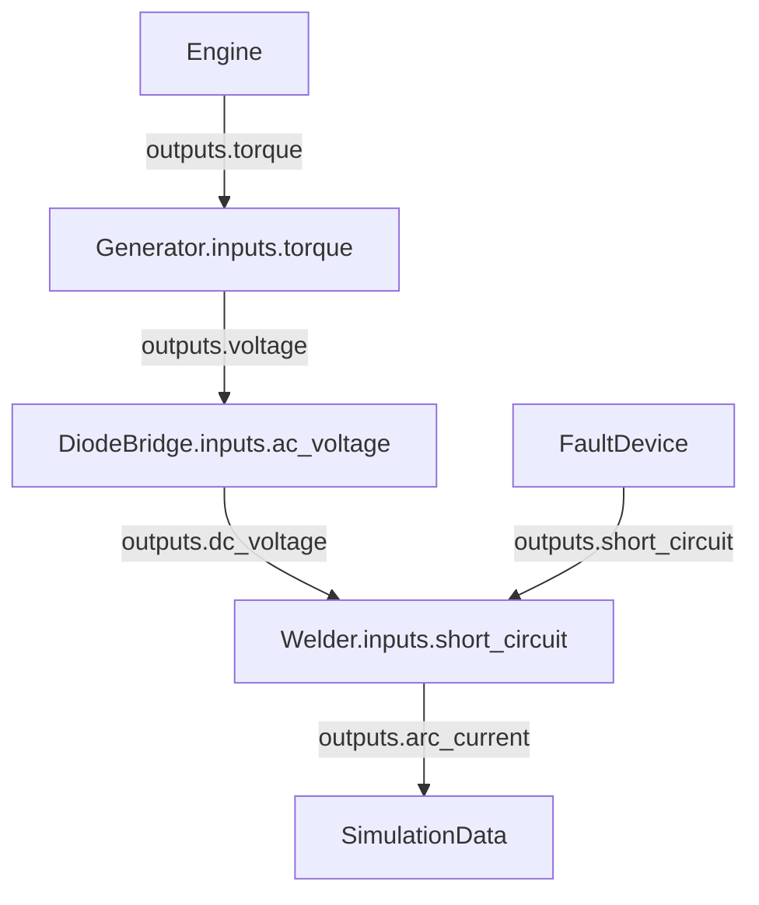

# HANDOFF - StaTable 連携 Phase 2 完了

**日付:** 2026-10-17
**最新コミット:** ccb208a (origin/main)
**次セッション用引き継ぎ資料（統合版）**

---

## 0. このファイルについて

このファイルは次セッションの冒頭で読む **単一の引き継ぎ資料** です。以下を統合しています:

1. **本編**: Phase 2 完了サマリ、ファイル構成、テスト、次期タスク
2. **付録 A**: SPEC_POWERSIM.md（Python シミュレーション設計指示書）
3. **付録 B**: STATABLE_INTEGRATION.md（StaTable 連携仕様書）

次セッションではこのファイルを読むだけで完全なコンテキストを得られます。

---

## 1. 現状サマリ

| 項目 | 状態 |
|---|---|
| Phase 1 実装 | ✅ 完了 |
| Phase 2-A (queue 層間配送) | ✅ 完了 |
| Phase 2-B-1 (ncalc→Python 変換) | ✅ 完了 |
| Phase 2-B-2 (condition/action eval) | ✅ 完了 |
| Phase 2-B-3 (E2E + バッチモード CLI) | ✅ 完了 |
| C# テスト (StaTable) | ✅ 79 件成功 |
| Python テスト (全件) | ✅ 315 件成功 |
| Python テスト (StaTable) | ✅ 50 件成功 |
| E2E (実 XML) | ✅ warnings: 0 で全 assertion pass |
| Git | ✅ origin/main に push 済み |

### コミット履歴（直近 5 件）

```
ccb208a feat(statable): Phase 2-B-3 - batch mode CLI + E2E verification
d8ae834 feat(statable): Phase 2-B-2 - condition/action eval with sandbox
002198a feat(statable): Phase 2-B-1 - ncalc to Python expression converter
fd30e72 feat(statable): Phase 2-A - queue event cross-layer delivery
00fbea3 feat(statable): Phase 1 - StaTable XML integration
```

### 達成したパイプライン（エンドツーエンド）

```
StaTable (外部ツール)
     ↓ design.xml (condition/action 含む)
[StaTableProjectReader]       (C# XML パーサ)
     ↓ StaTableProject モデル
[StaTableCodeGenerator]       (Python コード生成)
[NCalcToPythonConverter]      (ncalc → Python 式変換)
     ↓ controller_box.py (TRANSITIONS に Python 式が埋まる)
[python_runtime.statable]     (Python ランタイム)
     ├─ StaTableControllerBase._evaluate_condition()  ← eval + sandbox
     ├─ StaTableControllerBase._execute_action()      ← exec + sandbox
     └─ StaTableRuntime.tick()                        ← queue 層間配送
     ↓
7 層の状態機械が動作（条件・アクション込み）
```

---

## 2. ファイル構成

### 新規追加（C# 実装）

```
StaTableIntegration/
├── StaTableModel.cs               (データモデル / ~330 行)
├── StaTableProjectReader.cs       (XML パーサ / ~380 行)
├── StaTableCodeGenerator.cs       (コード生成 / ~340 行)
├── NCalcToPythonConverter.cs      (ncalc→Python 変換 / ~200 行) ← Phase 2-B-1
├── StaTableImportForm.cs          (UI フォーム / ~180 行)
└── StaTableImportForm.Designer.cs (UI デザイナ / ~180 行)
```

### 新規追加（C# テスト）

```
PowerSimBuilder.Tests/StaTable/
├── StaTableModelTests.cs             (15 テスト)
├── StaTableProjectReaderTests.cs     (18 テスト)
├── StaTableCodeGeneratorTests.cs     (24 テスト)
└── NCalcToPythonConverterTests.cs    (21 テスト) ← Phase 2-B-1
```

合計 78 テスト（StaTable フィルタで 79 件カウント、既存 1 件含む）

### 新規追加（Python ランタイム）

```
src/python_runtime/statable/
├── __init__.py                    (公開 API)
├── controller_base.py             (StaTableControllerBase / ~260 行)
└── runtime.py                     (StaTableRuntime / ~180 行)
```

### 新規追加（Python テスト）

```
tests/python/
└── test_statable_controller.py    (50 テスト / ~510 行)
```

### 修正ファイル

```
PowerSimBuilder.csproj              (7 ファイル登録)
PowerSimBuilder.Tests.csproj        (4 ファイル登録)
Program.cs                          (バッチモード CLI 追加) ← Phase 2-B-3
.gitattributes                      (改行コード正規化)
.gitignore                          (tmp/ 無視) ← Phase 2-B-3
```

### 生成されるファイル（実行時）

```
<ユーザー指定ディレクトリ>/
└── controller_box.py               (main.py と同じ場所)

バッチモードの場合:
<出力指定パス> (省略時は XML と同じディレクトリに controller_box_powersim.py)
```

---

## 3. セットアップ

### 環境要件

| 項目 | バージョン |
|---|---|
| OS | Windows |
| .NET Framework | 4.7.2 |
| C# LangVersion | latest (実質 C# 7.3 相当) |
| Visual Studio | 2022 Community |
| MSBuild | 17.14.40+ |
| Python | 3.13.7 |
| pytest | 9.1.1 |
| xUnit | 2.9.2 |
| ncalc | 1.3.8（既存参照） |

### 初回セットアップ

```powershell
cd C:\dev\PowerSimBuilder
python -m pip install -e .
```

---

## 4. テスト実行

### C# テスト（StaTable のみ）

```powershell
# 1. ビルド
& "C:\Program Files\Microsoft Visual Studio\2022\Community\MSBuild\Current\Bin\MSBuild.exe" `
    C:\dev\PowerSimBuilder\PowerSimBuilder.sln `
    /p:Configuration=Debug /t:Restore,Build /v:minimal

# 2. テスト
dotnet test C:\dev\PowerSimBuilder\PowerSimBuilder.Tests\PowerSimBuilder.Tests.csproj `
    --no-build --filter "FullyQualifiedName~StaTable" --verbosity minimal
```

**期待:** `合計: 79, 失敗数: 0`

### C# テスト（NCalcToPythonConverter のみ）

```powershell
dotnet test C:\dev\PowerSimBuilder\PowerSimBuilder.Tests\PowerSimBuilder.Tests.csproj `
    --no-build --filter "FullyQualifiedName~NCalcToPythonConverter" --verbosity minimal
```

**期待:** `合計: 21, 失敗数: 0`

### Python テスト（StaTable のみ）

```powershell
cd C:\dev\PowerSimBuilder
python -m pytest tests/python/test_statable_controller.py -v
```

**期待:** `50 passed`

### Python テスト（全件）

```powershell
python -m pytest tests/python -v
```

**期待:** `315 passed`

---

## 5. バッチモード & E2E

### バッチモード CLI（Phase 2-B-3 で追加）

```powershell
& "C:\dev\PowerSimBuilder\bin\Debug\PowerSimBuilder.exe" `
    --statable-import `
    "<xml_path>" `
    "<out.py_path>"
```

**終了コード:**

| コード | 意味 |
|:---:|---|
| 0 | 成功 |
| 1 | XML パースエラー |
| 2 | XML ファイル不在 |
| 3 | その他の例外 |

### GUI モード（後方互換）

```powershell
.\PowerSimBuilder.exe --statable-import
```

### E2E 検証（実 XML での動作確認）

**検証済みの動作（warnings: 0）:**

| # | 検証項目 | 結果 |
|:---:|---|:---:|
| 1 | 7 layers の runtime 構築 | ✅ |
| 2 | condition=False で遷移ブロック | ✅ |
| 3 | condition=True で遷移成功 | ✅ |
| 4 | action 実行（g_counter++） | ✅ |
| 5 | warnings 空 | ✅ |

**サンプル XML の場所:**

```
C:\Users\user\OneDrive\ドキュメント\GitHub\StaTable\dist_package\
  StaTable-CookingHeater-Package-v3.4.3\samples\cooking_heater_controller.xml
```

**注意:** 元 XML の `<Transition>` は condition/action が空。E2E 検証のためには XML DOM で書き換えて注入する必要がある（手順は前セッションのログ参照）。注入スクリプトの骨子:

```powershell
[xml]$doc = [System.IO.File]::ReadAllText($baseXml, $utf8NoBom)
foreach ($tab in $doc.SelectNodes("//Tab")) {
    foreach ($t in $tab.SelectNodes(".//Transition")) {
        if ($t.GetAttribute("source") -eq "InIdle" -and $t.GetAttribute("event") -eq "SENSOR_TICK") {
            $t.SetAttribute("condition", 'g_system_tick > 0')
            $t.SetAttribute("action", 'g_start_count = g_start_count + 1')
        }
    }
}
# ... Save with XmlWriterSettings
```

---

## 6. 実装の要点

### C# 側

| クラス | 役割 |
|---|---|
| `StaTableModel` | XML スキーマの POCO モデル（v2.2〜v3.8 対応） |
| `StaTableProjectReader` | XDocument でパース、SHA256 記録、警告収集 |
| `StaTableCodeGenerator` | Python ソース文字列を生成 |
| `NCalcToPythonConverter` | ncalc 式 → Python 式文字列変換 |
| `StaTableImportForm` | XML 選択→プレビュー→保存ダイアログ |

### Python 側

| クラス / 関数 | 役割 |
|---|---|
| `StaTableControllerBase` | 1 層 (Tab) = 状態機械。`Component` を継承 |
| `_SAFE_BUILTINS` | eval/exec のサンドボックス用 builtins 許可リスト |
| `_evaluate_condition()` | condition 式を eval で評価（エラー時 False） |
| `_execute_action()` | action 式を exec で実行（エラー時 warning のみ） |
| `_bind_runtime()` | runtime から `self.globals` を参照共有 |
| `StaTableRuntime` | 全層を priority 昇順で管理、queue 配送 |
| `StaTableRuntime.enqueue()` | queue イベント投入 |
| `StaTableRuntime.tick()` | 先頭で queue drain → 各層 update |

### 変換テーブル（NCalcToPythonConverter）

| ncalc | Python | 備考 |
|---|---|---|
| `&&` | `and` | 論理積 |
| `||` | `or` | 論理和 |
| `!x` | `not x` | 単項否定（`!=` は除外） |
| `g_xxx` | `self.globals["g_xxx"]` | グローバル変数 |
| `F_xxx(...)` | `self.F_xxx(...)` | RoleFunction 呼び出し |
| `true` / `false` | `True` / `False` | 真偽値 |
| `null` | `None` | null |
| 三項演算子 `a ? b : c` | **未対応** | Phase 2-B' 以降 |

### サンドボックス

```python
_SAFE_BUILTINS = {
    "abs": abs, "min": min, "max": max, "round": round,
    "int": int, "float": float, "bool": bool, "str": str, "len": len,
    "True": True, "False": False, "None": None,
}
# eval/exec 時: {"__builtins__": _SAFE_BUILTINS, "self": self}
# → import / open / __ 系は呼べない
```

### 生成コードの重要マーカー

```python
# STABLE_USER_CODE_START:<Layer>.<Function>
<ユーザー実装>
# STABLE_USER_CODE_END:<Layer>.<Function>
```

→ 再生成時にユーザー実装を保護する仕組み（StaTable 本体と同じ思想）

---

## 7. 既知の制約（バックログ）

### Phase 2-B' で対応予定

| # | 制約 | 対応予定 |
|:---:|---|---|
| 1 | **RoleFunction 未定義時の AttributeError** | ジェネレータが `F_xxx` 参照を抽出し、no-op メソッドを自動生成（Phase 2-B'） |
| 2 | **三項演算子 `a ? b : c` 未対応** | NCalcToPythonConverter に変換追加 |
| 3 | **C++ 構文の `<Action>` 未対応** | `ctx->data.g_system_tick++` 形式は現状スキップ |

### Phase 2-C で対応予定

| # | 制約 | 対応予定 |
|:---:|---|---|
| 4 | **MainForm メニュー未統合** | 通常 GUI から StaTableImportForm を呼び出し |

### Phase 3 以降

| # | 制約 | 対応予定 |
|:---:|---|---|
| 5 | **RoleFunction は no-op スタブ** | ユーザー実装待ち（STABLE_USER_CODE 内） |
| 6 | **queue イベントの action 自動送信** | action 内で `self.queue_event(...)` を自動化 |
| 7 | **v0.3.0 リリース** | Phase 2 をバージョン固定 |

---

## 8. 次のタスク（優先度順）

| # | タスク | 内容 | 優先度 | 工数 |
|:---:|---|---|:---:|:---:|
| **B'** | RoleFunction 動的スタブ | 未定義 `F_xxx` を no-op 化 | 🟡 中 | 1h |
| **C** | MainForm メニュー統合 | 通常 GUI から呼び出し | 🟡 中 | 1h |
| **2-B''** | 三項演算子対応 | `a ? b : c` → Python | 🟢 低 | 30m |
| **3-A** | RoleFunction 本体実装 | STABLE_USER_CODE 展開 | 🔴 高 | 数日 |

### タスク B' の着手方法

1. `StaTableCodeGenerator.WriteLayerClass` で action/condition 文字列をスキャン
2. 正規表現 `\b(F_[A-Za-z0-9_]+)\b` で `F_xxx` を抽出
3. クラス内の `RoleFunctions` に無い `F_xxx` を no-op メソッドとして追加生成
4. テスト追加（`StaTableCodeGeneratorTests.cs`）

### タスク C の着手方法

1. `MainForm.Designer.cs` にメニュー項目追加
2. `MainForm.cs` に `MenuItem.Click` ハンドラ追加
3. `StaTableImportForm` を `ShowDialog()` で呼ぶ

---

## 9. 次セッション開始時のチェックリスト

```powershell
cd C:\dev\PowerSimBuilder

# 1. HEAD の確認（ccb208a が HEAD か）
git log --oneline -5
git status

# 2. editable install 確認
python -m pip install -e .

# 3. C# テスト
& "C:\Program Files\Microsoft Visual Studio\2022\Community\MSBuild\Current\Bin\MSBuild.exe" `
    C:\dev\PowerSimBuilder\PowerSimBuilder.sln `
    /p:Configuration=Debug /t:Restore,Build /v:minimal
dotnet test C:\dev\PowerSimBuilder\PowerSimBuilder.Tests\PowerSimBuilder.Tests.csproj `
    --no-build --filter "FullyQualifiedName~StaTable" --verbosity minimal

# 4. Python テスト
python -m pytest tests/python/test_statable_controller.py -v
```

**期待:**

- HEAD = `ccb208a`
- work tree clean
- C# StaTable テスト 79 件 pass
- Python StaTable テスト 50 件 pass

---

## 10. セッション再開時のプロンプト例

```
StaTable 連携の Phase 2 は完了しました。
HANDOFF_STATABLE.md（統合版）を読んで、
次のタスク（B' / C / 2-B''）から着手してください。

最新コミット: ccb208a
C# テスト: 79 件 / Python テスト: 315 件 すべて pass
E2E: warnings 0 で全 assertion pass

まず着手したいタスクを教えてください。
```

---

## 📚 参考情報

### StaTable リポジトリ

- URL: https://github.com/akashi-hideki/StaTable
- サンプル XML: `dist_package/StaTable-CookingHeater-Package-v3.4.3/samples/cooking_heater_controller.xml`
- 7 層 / 31 状態 / 60 Role 関数

### 主要な仕様書（このファイルの付録）

- **付録 A**: SPEC_POWERSIM.md（Python シミュレーション設計指示書）
- **付録 B**: STATABLE_INTEGRATION.md（StaTable 連携仕様書）

### このセッションで得た教訓

| やること | やらないこと |
|---|---|
| `[System.IO.File]::ReadAllText($p, $utf8NoBom)` | `Get-Content -Raw`（エンコーディング未指定） |
| `[System.IO.File]::WriteAllText($p, $s, $utf8NoBom)` | `Set-Content`（BOM 付き UTF-8 になりがち） |
| 日本語入りファイルは **完全書き直し** | `Read→Replace→Write`（破損リスク高） |
| 長い commit message は **ファイルに書いて `-F`** | `-m "..."` 内に `\"` を書く |
| PowerShell の escape は `` ` `` バッククォート | `\` バックスラッシュ（Windows パス以外では使えない） |

---

## 付録 A: SPEC_POWERSIM.md（Python シミュレーション設計指示書）

以下は元ファイルの内容をそのまま保持。実装状況は本編「1. 現状サマリ」を参照。

---

# Pythonシミュレーション設計指示書（完全版）

## 1. 目的

- 電源、発電機、整流器、溶接機、エンジン、誘導電動機、故障装置の時間シミュレーション
- 共通インタフェースで部品管理：
  - 初期化メソッド (`__init__`)
  - 更新メソッド (`update`)
  - 入力/出力ポート (`inputs`, `outputs`)
- 出力を次の部品入力へ伝搬
- 条件付きシナリオ制御をコンポーネント内部で管理
- JSON/辞書形式で自動生成・VC#ネットリスト変換対応

---

## 2. 共通データ構造

### 2.1 SimulationData（全パラメータ集約）

- 電源・発電機：電圧、電流、周波数、波形
- 整流回路：ダイオード降下、整流方式、リップル、出力電圧
- 溶接機：設定電流、実電流、制御モード、過熱フラグ
- 故障：短絡、開放、突入電流
- 誘導電動機：定格出力、トルク、回転数、すべり
- 全体制御：時間刻み、ログ

### 2.2 Component基底クラス

- ID、タイプ、パラメータ辞書
- inputs, outputs 辞書
- update(t, dt, sim_data) メソッド

```python
class Component:
    def __init__(self, comp_id, comp_type):
        self.id = comp_id
        self.type = comp_type
        self.parameters = {}
        self.inputs = {}
        self.outputs = {}

    def update(self, t, dt, sim_data):
        pass
```

## 3. コンポーネント詳細

| クラス | パラメータ | 入力 | 出力 | 補足 |
| --- | --- | --- | --- | --- |
| PowerSource | voltage, frequency, waveform | - | voltage, current | AC出力 |
| Generator | rated_power, efficiency | torque | voltage, current | 発電機駆動 |
| DiodeBridge | diode_drop, type | ac_voltage | dc_voltage, ripple | 半波/全波/三相 |
| Welder | welding_current_set, mode, overheat_limit | dc_voltage, short_circuit | arc_current, overheat | 定電流/定電圧制御 |
| Engine | power, torque_max | - | torque | 発電機駆動トルク |
| InductionMotor | rated_power, load_torque | voltage | torque, speed, slip | 応答遅れ・負荷トルク |
| FaultDevice | fault_type, condition_expr, duration | - | short_circuit, open_circuit, inrush_current | update内でシナリオ判定・状態管理 |

---

## 4. Connections 原理

- 出力→入力の接続を辞書化・JSON化
- MAIN ループで update 後に伝搬
- FaultDevice も同様に接続反映

### 4.1 Mermaid 図例



### 4.2 JSON形式例

```json
[
  {"from":"engine.outputs.torque","to":"generator.inputs.torque"},
  {"from":"generator.outputs.voltage","to":"bridge.inputs.ac_voltage"},
  {"from":"bridge.outputs.dc_voltage","to":"welder.inputs.dc_voltage"},
  {"from":"fault1.outputs.short_circuit","to":"welder.inputs.short_circuit"}
]
```

---

## 5. FaultDevice 内部シナリオ管理

- condition_expr と duration でトリガー判定
- scenario_state を内部保持
- MAIN ループから状態管理不要

```python
class FaultDevice(Component):
    def __init__(self, comp_id, comp_type):
        super().__init__(comp_id, comp_type)
        self.parameters = {"fault_type":"none","condition_expr":"False","duration":0.0}
        self.outputs = {"short_circuit":False,"open_circuit":False,"inrush_current":0.0}
        self._scenario_state = {"t_start_cond":None,"triggered":False}

    def update(self, t, dt, sim_data):
        cond_result = eval(self.parameters.get("condition_expr","False"))
        if cond_result:
            if self._scenario_state["t_start_cond"] is None:
                self._scenario_state["t_start_cond"] = t
            elif t - self._scenario_state["t_start_cond"] >= self.parameters.get("duration",0):
                if not self._scenario_state["triggered"]:
                    self.outputs["short_circuit"] = True
                    self.outputs["inrush_current"] = self.parameters.get("inrush_current",0.0)
                    self._scenario_state["triggered"] = True
        else:
            self._scenario_state["t_start_cond"] = None
            self._scenario_state["triggered"] = False
```

---

## 6. MAINループ設計

- SimulationData 生成
- Components 登録
- Connections 伝搬
- update → 接続 → ログ収集

```python
def main():
    import numpy as np
    dt = 0.001
    t_end = 5.0
    sim_data = SimulationData()
    sim_data.time_step = dt

    components = {
        "power": PowerSource("power","PowerSource"),
        "generator": Generator("generator","Generator"),
        "bridge": DiodeBridge("bridge","DiodeBridge"),
        "welder": Welder("welder","Welder"),
        "engine": Engine("engine","Engine"),
        "motor": InductionMotor("motor","InductionMotor"),
        "fault1": FaultDevice("fault1","FaultDevice")
    }

    connections = [
        {"from":"engine.outputs.torque","to":"generator.inputs.torque"},
        {"from":"generator.outputs.voltage","to":"bridge.inputs.ac_voltage"},
        {"from":"bridge.outputs.dc_voltage","to":"welder.inputs.dc_voltage"},
        {"from":"fault1.outputs.short_circuit","to":"welder.inputs.short_circuit"}
    ]

    for t in np.arange(0, t_end, dt):
        for comp in components.values():
            comp.update(t, dt, sim_data)

        for conn in connections:
            f_c,f_p = conn["from"].split(".")
            t_c,t_p = conn["to"].split(".")
            components[t_c].inputs[t_p] = components[f_c].outputs[f_p]

        sim_data.logs.append({
            "time": t,
            "components": {cid: {"inputs": comp.inputs.copy(),
                                 "outputs": comp.outputs.copy(),
                                 "parameters": comp.parameters.copy()}
                           for cid, comp in components.items()}
        })
```

---

## 7. VC# ネットリスト変換対応

- Components / Connections を JSON で保持
- FaultDevice の condition_expr も文字列で保持
- 自動生成ツールで scenario_expr 設定
- SPICE形式に変換可能

---

## 付録 B: STATABLE_INTEGRATION.md（StaTable 連携仕様書）

**注記（2026-10-17 追記）:** 以下の元仕様書は「実装（将来対応）」として書かれていますが、Phase 2 完了時点で **全モジュール実装済み・テスト通過・E2E 検証済み** です。実装状況は本編「1. 現状サマリ」を参照してください。なお、`StaTableCodeGenerator.cs` には Phase 2-B-1 で `NCalcToPythonConverter.cs` の呼び出しが追加されています。

---

以下は元ファイルの内容をそのまま保持。

---

# StaTable 連携仕様書

## 目的
StaTable（独立ツール）で設計した状態機械 XML を
PowerSimBuilder に取り込み、Python 制御ボックスコードを自動生成する。

## ステータス
- [x] 設計完了
- [x] 実装（Phase 1 + Phase 2 完了: 2026-10-17）
  - Phase 1: 基本パイプライン（XML 読込 → Python 生成 → 実行）
  - Phase 2-A: queue イベント層間配送
  - Phase 2-B-1: ncalc → Python 式変換
  - Phase 2-B-2: condition / action の eval / exec（サンドボックス）
  - Phase 2-B-3: E2E 検証 + バッチモード CLI

## アーキテクチャ
StaTable (独立) → design.xml → PowerSimBuilder → controller_box.py

## 追加モジュール（実装済み）
- StaTableIntegration/StaTableModel.cs
- StaTableIntegration/StaTableProjectReader.cs
- StaTableIntegration/StaTableCodeGenerator.cs
- StaTableIntegration/NCalcToPythonConverter.cs（Phase 2-B-1 で追加）
- StaTableIntegration/PythonCodeTemplates.cs（現状は StaTableCodeGenerator 内に統合）
- StaTableIntegration/StaTableImportForm.cs

## 詳細
（前回提示した設計内容をここに貼り付け）

---

**End of HANDOFF**


---

# Phase 2 拡張 + Phase 3 準備（2026-10-17 追記）

**HEAD:** `963ee8a` (origin/main)

## 11. 本セッションの完了タスク

| # | タスク | コミット | 内容 |
|:---:|---|---|---|
| **B'** | RoleFunction 動的スタブ | `1f39047` | 未定義 `F_xxx` を no-op スタブ自動生成（B'） |
| **2-B''** | 三項演算子対応 | `52ba7a6` | `a ? b : c` → `(b if a else c)` |
| **B''-prefix** | `F_` プレフィックス正規化 | `9f2b73a` | `RoleFunctions.Name` に `F_` を自動付与 |
| **C** | MainForm 統合 | `d4913c4` | ツールバーに「StaTable取込」ボタン追加 |
| **案 A** | ファイルダイアログ | `963ee8a` | 読み込み/保存に `OpenFileDialog` / `SaveFileDialog` |

## 12. テスト状況

| スコープ | 件数 | 状態 |
|---|---:|---|
| C# `StaTable` 全体 | **94** | ✅ pass |
| C# `NCalcToPythonConverter` | 29 | ✅ pass |
| C# `StaTableCodeGenerator` | 32 | ✅ pass |
| Python 全体 | 315 | ✅ pass |
| Python `StaTable` | 50 | ✅ pass |

## 13. E2E 検証結果

| タスク | 検証内容 | 結果 |
|---|---|:---:|
| B' | 実 XML に `F_undefined_test()` を注入 → スタブ生成確認 | ✅ |
| 2-B'' | 三項演算子 + 未定義 `F_xxx` の連携確認 | ✅ |
| B''-prefix | 実 XML の RoleFunction を `F_` 付きで参照 → 定義と参照の一致確認 | ✅ |

## 14. 実装の追加ポイント

### 三項演算子変換（`NCalcToPythonConverter.cs`）

| ncalc | Python |
|---|---|
| `a ? b : c` | `(b if a else c)` |
| `a ? b : c ? d : e` | `(b if a else (d if c else e))`（右結合） |
| `(a ? b : c) > 0` | `(b if a else c) > 0` |

- 実装: `ConvertTernary` / `FindTopLevelQuestionMark` / `FindMatchingColon` / `RecurseIntoParens` / `IsBalancedParens`
- `ConvertCore` のステップ 7 に挿入

### `F_` プレフィックス正規化（`StaTableCodeGenerator.cs`）

- `NormalizeRoleFunctionName(string)`: `F_` が無ければ付与、既に付いていれば二重付与しない
- `WriteRoleFunction`: 正規化名で `def F_xxx(self):` を出力
- `CollectMissingRoleFunctions`: `defined` 集合も正規化して比較（B' のスタブ二重生成防止）

### B' のスタブ生成（`StaTableCodeGenerator.cs`）

- 未定義 `F_xxx` を Ordinal 昇順で no-op スタブ化
- シグネチャ: `(self, *args, **kwargs)`（引数不一致による `TypeError` 防止）
- 戻り値: `return 0`（`None` 比較による `TypeError` 防止）
- `STABLE_USER_CODE_START/END` で再生成時のユーザー実装保護

## 15. 既知の制約（更新版）

### Phase 3 以降

| # | 制約 | 対応予定 |
|:---:|---|---|
| 1 | **RoleFunction は no-op スタブ** | Phase 3-A でユーザー実装（`STABLE_USER_CODE` 内） |
| 2 | **別レイヤーの `F_xxx` 参照は no-op** | `B''-warn`（警告追加、優先度 🟢 低） |
| 3 | **裸の RoleFunction 名（`F_` なし）は変換されない** | `B''-bare`（自動変換/警告、優先度 🟢 低） |
| 4 | **queue イベントの action 自動送信** | action 内で `self.queue_event(...)` を自動化 |
| 5 | **v0.3.0 リリース** | Phase 2 をバージョン固定 |

## 16. 次のタスク（優先度順）

| # | タスク | 内容 | 優先度 | 工数 |
|:---:|---|---|:---:|:---:|
| **3-A** | RoleFunction 本体実装 | `STABLE_USER_CODE` 展開（120 関数） | 🔴 高 | 数日 |
| **B''-warn** | 別レイヤー参照の警告 | レイヤー跨ぎの `F_xxx` を警告 | 🟢 低 | 30m |
| **B''-bare** | 裸の RoleFunction 名の検出 | `F_` なし参照の自動変換/警告 | 🟢 低 | 30m |
| **v0.3.0** | リリース | Phase 2 のバージョン固定 | 🟡 中 | 1h |

## 17. 本セッションの教訓

### PowerShell の罠

| やること | やらないこと |
|---|---|
| `Write-Host ("..." -f $x) -ForegroundColor Green` のように `-f` を括弧で囲む | `Write-Host "..." -f $x -ForegroundColor Green`（`-ForegroundColor` が `-f` に吸い込まれる） |
| `[regex]::Escape()` でリテラル化してから `-match` | 生の `()` を `-match` に埋め込む（メタ文字事故） |
| 複数行スクリプトは `function` でラップ | 一括貼り付けで `throw` に頼る（後続行が実行される） |
| 生成コード内の文字列は `Contains()` でリテラル比較 | エスケープ済み/未エスケープの混同（`\"` vs `"`） |
| E2E はファイル可視性リトライ（最大 5 秒）を入れる | CLI 直後の `Test-Path` 1 回で判断（false negative あり） |

### WinForms の罠

| やること | やらないこと |
|---|---|
| `ToolStripButton` の `new` は `toolStrip1.Items.AddRange` の**前** | プロパティ設定エリアで `new`（AddRange 時に null でクラッシュ） |
| EXE ロック時はプロセス終了 → 解放待ち（リトライ） | ロックしたままビルド（`MSB3026`/`MSB3027`） |

### 設計上の知見

| 知見 | 内容 |
|---|---|
| **StaTable の RoleFunction はレイヤー単位** | 別レイヤーの `F_xxx` は同一クラスから呼べない → B' が no-op スタブで安全に吸収 |
| **`F_` プレフィックスは呼び出し規約** | XML の `RoleFunctions.Name` は `F_` なしでも、生成コード側で正規化する |
| **ファイルダイアログの導入** | 固定パス `system.json` はユーザビリティが低い。標準ダイアログで任意パス対応 |

---

**End of Session Append**

---

# Task 3-A 完了（2026-10-17 追記）

**HEAD:** `7c96489` (origin/main)

## 18. 3-A で完了したタスク

| # | タスク | コミット | 内容 |
|:---:|---|---|---|
| **3-0** | STABLE_USER_CODE 保存機構 | `20e0b41` | マーカー内ユーザー実装を再生成時に保持 |
| **3-A-1** | DriverInput 6 関数 | `ba99ae1` | センサー EMA / queue_event / ドア安全停止 |
| **3-A-2-A** | DriverOutput 13 関数 | `a7f974c` | ヒータ / ファン / ポンプ / マグネトロン制御 |
| **3-A-2-B** | Application 10 関数 | `0198bdd` | シーケンス制御 / エラー管理 |
| **3-A-3** | Mw* 4 層 31 関数 | `7c96489` | MwMicrowave / MwGrill / MwOven / MwSteam |

**合計: 60 / 60 関数実装完了**

## 19. 実装内容の要点

### グローバル変数マッピング

| 変数 | 用途 | 使用層 |
|---|---|---|
| `g_system_tick` | 決定的疑似ノイズ生成 | DriverInput, MwOven, MwSteam |
| `error_code` | エラーコード（0xE1=MW, 0xE2=GR, 0xE3=OV, 0xE4=ST） | 全層 |
| `heater_*_on/duty` | ヒータ制御 | DriverOutput, MwGrill, MwOven, MwSteam |
| `fan_on/duty` | ファン制御 | DriverOutput, MwOven |
| `pump_on/pulse_count` | ポンプ制御 | DriverOutput, MwSteam |
| `mag_on/mw_power/mw_target_power` | マグネトロン | DriverOutput, MwMicrowave |
| `seq_step/seq_total/stage_*` | シーケンス制御 | Application |
| `door_open` | 安全フラグ | DriverInput |

### 設計パターン

- **決定的シミュレーション**: `g_system_tick` からノイズを生成（乱数不使用、再現性確保）
- **エラーコード方式**: `LogXxxFault` は既存 `error_code` を保持、`ClearXxxFault` は該当コードのみクリア
- **`_on` と `_duty` の同期**: `SetXxxPwm` は `duty > 0` → `on = 1` の規則
- **PID 制御**: `CalculateSteamPID` は P 制御（gain=1、clamp 0..100）

### エラーコード

| コード | 層 | 意味 |
|---|---|---|
| `0xE1` | MwMicrowave | マグネトロン故障 |
| `0xE2` | MwGrill | グリル故障 |
| `0xE3` | MwOven | オーブン故障 |
| `0xE4` | MwSteam | スチーム故障 |

## 20. テスト状況

| スコープ | 件数 | 状態 |
|---|---:|---|
| C# StaTable 全体 | 94 | ✅ pass |
| DriverInput 直接呼び出し | 6 | ✅ pass |
| DriverOutput 直接呼び出し | 13 | ✅ pass |
| Application 直接呼び出し | 10 | ✅ pass |
| Mw* 4 層直接呼び出し | 31 | ✅ pass |
| 回帰（3 層連携） | 3 | ✅ pass |

## 21. 残タスク

| # | タスク | 内容 | 優先度 |
|:---:|---|---|:---:|
| **3-B** | 統合動作確認 | 7 層 tick ベースのシナリオテスト | 🟡 中 |
| **v0.3.0** | リリース | Phase 2 + 3-A のバージョン固定 | 🟡 中 |
| **B''-warn** | 別レイヤー参照警告 | レイヤー跨ぎ `F_xxx` の警告 | 🟢 低 |
| **B''-bare** | 裸 RoleFunction 名検出 | `F_` なし参照の自動変換 | 🟢 低 |

## 22. 本セッション（3-A）の教訓

### pre-commit `mixed-line-ending` 対策

**問題**: 生成コードが CRLF を含むため、コミットのたびに `mixed-line-ending` が発動し、2 回コミットが必要。

**対策**:
- コミット前に `.Replace("
", "
")` で LF 正規化
- 次回以降は `StaTableCodeGenerator.GenerateToFile` で `\n` 出力に統一するか、`.gitattributes` で `generated/*.py text eol=lf` を指定

### PowerShell の罠

| やること | やらないこと |
|---|---|
| `git commit -m "..."` を直接使う（短いメッセージ） | ヒアドキュメント `@'...'@`（Ctrl+C で中断リスク） |
| 長いメッセージは `feat(statable): implement Mw* RoleFunctions (Task 3-A-3)

MwMicrowave (6) / MwGrill (6) / MwOven (10) / MwSteam (9) = 31 関数を実装。

実装:
- MwMicrowave: magnetron 制御 + anode 電流監視
- MwGrill: グリルヒーター制御 + 過熱判定
- MwOven: PID bit 制御 + 3 ヒータ duty + ファン + サーミスタ読み取り + 過熱判定
- MwSteam: ボイラーヒーター + ポンプパルス + 温度読み取り + P 制御 PID + 過熱判定

エラーコード: 0xE1 (MW) / 0xE2 (GR) / 0xE3 (OV) / 0xE4 (ST)

Tests: 31 関数 + 3 層回帰 PASS = "..."` + `git commit -m feat(statable): implement Mw* RoleFunctions (Task 3-A-3)

MwMicrowave (6) / MwGrill (6) / MwOven (10) / MwSteam (9) = 31 関数を実装。

実装:
- MwMicrowave: magnetron 制御 + anode 電流監視
- MwGrill: グリルヒーター制御 + 過熱判定
- MwOven: PID bit 制御 + 3 ヒータ duty + ファン + サーミスタ読み取り + 過熱判定
- MwSteam: ボイラーヒーター + ポンプパルス + 温度読み取り + P 制御 PID + 過熱判定

エラーコード: 0xE1 (MW) / 0xE2 (GR) / 0xE3 (OV) / 0xE4 (ST)

Tests: 31 関数 + 3 層回帰 PASS` | 配列 `@(...)` + `WriteAllText`（pre-commit 修正で再実行が必要） |
| `function` 定義 + 実行行をセットで貼る | 説明文・期待結果の例を混ぜて貼る |

### 実装上の知見

- **層ごとの独立性**: DriverOutput / Mw* は機械的、Application はシーケンス制御
- **エラーコード方式**: 既存保持 + 該当コードのみクリアで、層間の独立性を確保
- **決定的シミュレーション**: `g_system_tick` ベースの擬似ノイズで再現性確保

---

**End of Task 3-A**
