# C++集中学習カリキュラム：1週間でコードを読めるようになるための完全ガイド

## 📚 学習目標

既存のC、C#の知識を活かし、1日1時間×7日間で基本的なC++コードの読解ができるようになる

## 🗓 カリキュラム概要

### 📍 Day 1: C++の基本構造とCからの違いを理解する（1時間）

**ポイント**: メモリ管理の違いと基本的な構文

#### Cとの類似点と相違点

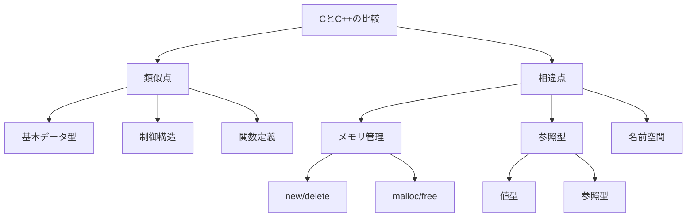

#### メモリ管理の比較

```cpp
// Cスタイル
int *p = (int*)malloc(sizeof(int) * 10);
free(p);

// C++スタイル
int *p = new int;       // 単一オブジェクト
int *arr = new int[10]; // 配列
delete p;     // 単一オブジェクト解放
delete[] arr; // 配列解放
```

#### 参照の概念

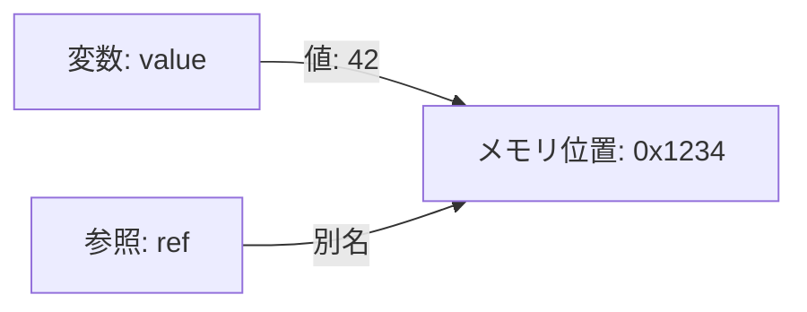

```cpp
int value = 42;
int &ref = value; // refはvalueへの参照
ref = 100;        // valueの値も100に変わる
```

### 📍 Day 2: クラスとオブジェクト指向の基本（1時間）

**ポイント**: C#のクラス概念との比較

#### クラスの基本構造

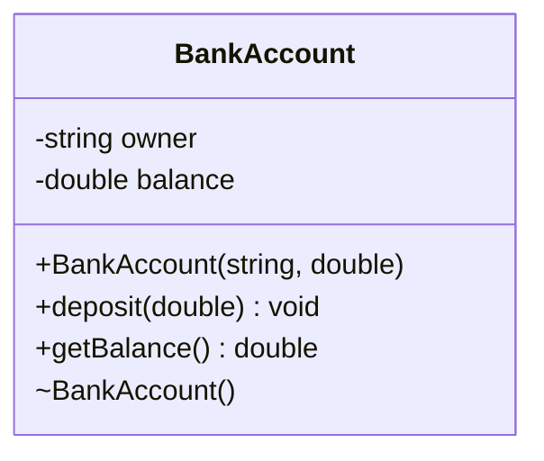

```cpp
class BankAccount {
private:
    std::string owner;
    double balance;
  
public:
    BankAccount(const std::string& owner, double balance) 
        : owner(owner), balance(balance) {}
  
    void deposit(double amount) {
        if (amount > 0) balance += amount;
    }
  
    double getBalance() const { return balance; }
  
    ~BankAccount() {
        std::cout << "Account closed for " << owner << std::endl;
    }
};
```

#### アクセス指定子の概念

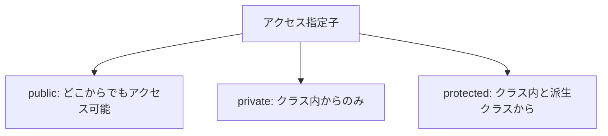

### 📍 Day 3: メモリ管理とポインタ（1時間）

**ポイント**: 明示的なメモリ管理の理解

#### スマートポインタの比較

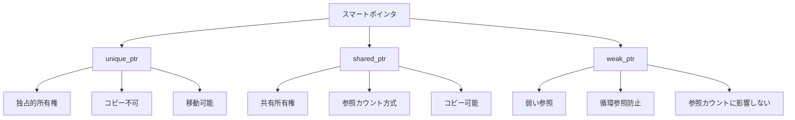

#### スマートポインタの使用例

```cpp
#include <memory>

// unique_ptr - 独占的所有権
auto uniquePtr = std::make_unique<int>(42);

// shared_ptr - 共有所有権
auto sharedPtr = std::make_shared<int>(42);
auto sharedPtr2 = sharedPtr; // コピー可能、参照カウント増加

// 参照カウントの確認
std::cout << sharedPtr.use_count() << std::endl; // 2
```

### 📍 Day 4: テンプレートとジェネリックプログラミング（1時間）

**ポイント**: C#のジェネリックとの類似点と相違点

#### テンプレートの概念

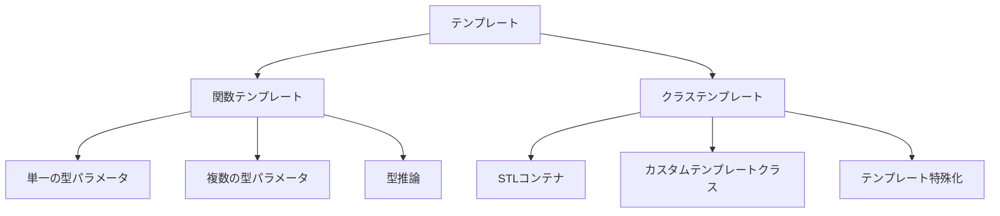

#### テンプレートの使用例

```cpp
// 関数テンプレート
template <typename T>
T max(T a, T b) {
    return (a > b) ? a : b;
}

// クラステンプレート
template <typename T, size_t Capacity = 10>
class FixedArray {
private:
    T data[Capacity];
    size_t size = 0;
  
public:
    void push_back(const T& value) {
        if (size < Capacity) data[size++] = value;
    }
};
```

📍 Day 6: 継承とポリモーフィズム（1時間）

**ポイント**: C#との比較で理解する

#### 継承関係の図解

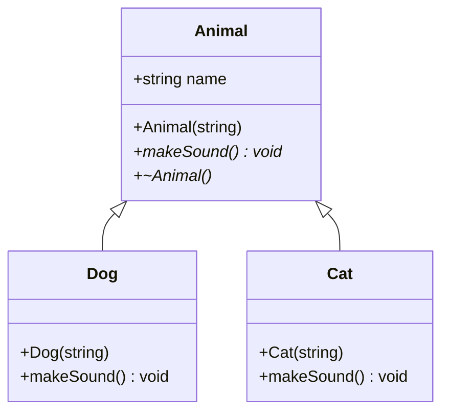

#### ポリモーフィズムの概念

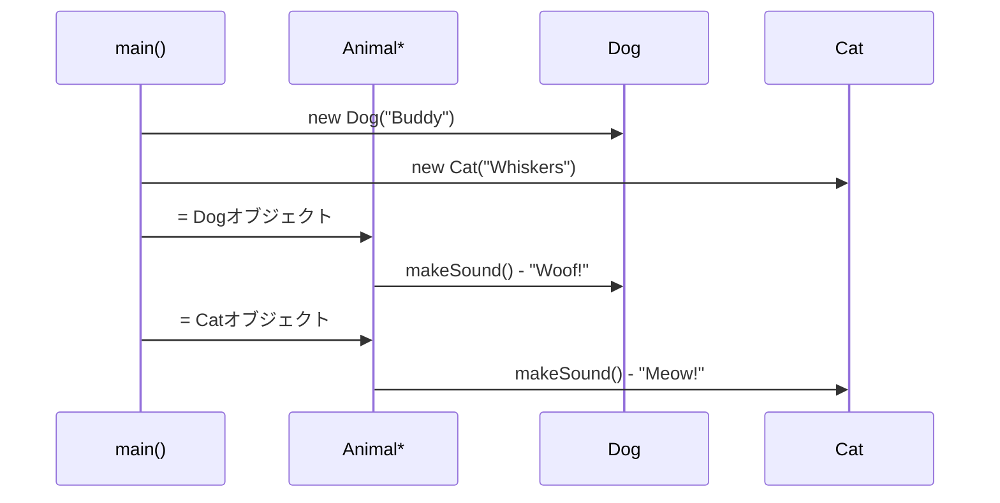

#### コード例

```cpp
class Animal {
public:
    virtual void makeSound() const = 0;
    virtual ~Animal() {}
};

class Dog : public Animal {
public:
    void makeSound() const override {
        std::cout << "Woof!" << std::endl;
    }
};

class Cat : public Animal {
public:
    void makeSound() const override {
        std::cout << "Meow!" << std::endl;
    }
};
```

### 📍 Day 7: 実践的なコード読解練習（1時間）

**ポイント**: 実際のコードを読んでみる

#### RAIIパターンの概念

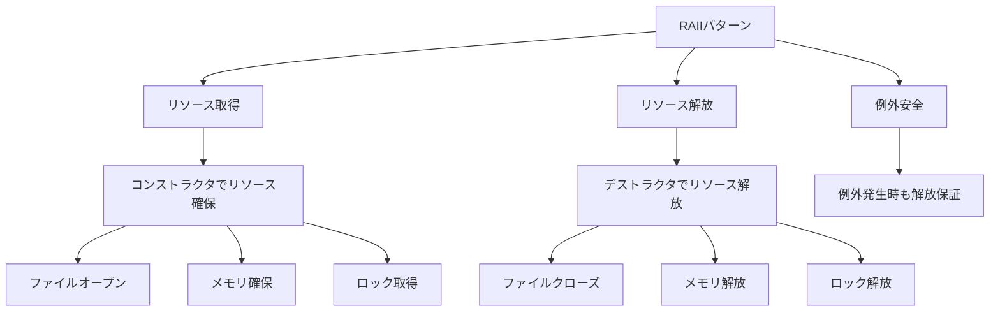

#### RAIIの実装例

```cpp
#include <fstream>
#include <memory>
#include <mutex>

// ファイルRAII
class FileHandler {
private:
    std::unique_ptr<std::fstream> file;
  
public:
    FileHandler(const std::string& filename) {
        file = std::make_unique<std::fstream>(filename);
        if (!file->is_open()) {
            throw std::runtime_error("Failed to open file");
        }
    }
  
    ~FileHandler() {
        if (file && file->is_open()) {
            file->close();
        }
    }
};

// ロックRAII
class ScopedLock {
private:
    std::mutex& mutex;
  
public:
    explicit ScopedLock(std::mutex& m) : mutex(m) {
        mutex.lock();
    }
  
    ~ScopedLock() {
        mutex.unlock();
    }
};
```

## 🎯 効率的な学習のためのアドバイス

### 学習プロセスの可視化

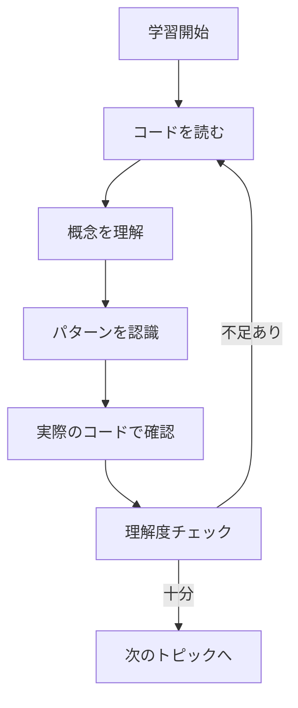

1. **コードを書かずに読むことに集中**

   - 既存コードの読解に重点を置く
   - オープンソースプロジェクトを読んでみる
2. **C#と比較しながら学ぶ**

   - 類似点と相違点を対比して理解
   - C#の`List<T>` ≈ C++の`std::vector<T>`
   - C#の`Dictionary<K,V>` ≈ C++の`std::map<K,V>`
3. **よく使われるパターンを優先的に覚える**

   - RAIIパターン
   - スマートポインタの使用パターン
   - STLコンテナとアルゴリズムの組み合わせ

## 🔍 重点的に押さえるべきポイント

### メモリ管理の比較表


| 特徴     | 生ポインタ | unique_ptr | shared_ptr         |
| -------- | ---------- | ---------- | ------------------ |
| 所有権   | 明示的管理 | 独占的     | 共有               |
| コピー   | 可能       | 不可       | 可能               |
| 移動     | 手動       | 可能       | 可能               |
| 解放     | 手動       | 自動       | 自動(参照カウント) |
| 循環参照 | 問題ない   | 問題ない   | 問題あり           |

### クラス設計のベストプラクティス

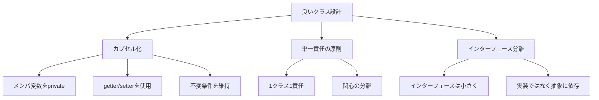

## 💡 まとめ

このカリキュラムでは、図解を多用してC++の核心概念を視覚的に理解できるようにしました。各日の学習では、コード例と図を対比させながら、C++の独特な概念やパターンに慣れることを目指しましょう。

特に重要なのは：

1. **メモリ管理**の違いとスマートポインタの適切な使用方法
2. **RAIIパターン**によるリソース管理の自動化
3. **テンプレート**とSTLの効果的な活用
4. **オブジェクト指向**の正しい実装方法

図解を通して、これらの概念がより明確に理解できるはずです。実際のコードを読みながら、これらのパターンを識別する練習を積み重ねることが、C++コード読解力向上の近道です。


# Day 5: 標準ライブラリ(STL)の基本 - 拡張版

## 📚 学習目標

C++標準ライブラリ(STL)の主要なコンテナ、アルゴリズム、ユーティリティを理解し、実際のコードでそれらを識別できるようになる

## 🗓 カリキュラム詳細

### 📍 STLコンテナの体系的理解

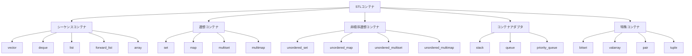

### 📍 主要コンテナの詳細比較

#### 1. シーケンスコンテナ

```cpp
#include <vector>
#include <deque>
#include <list>
#include <forward_list>
#include <array>

// vector: 動的配列（ランダムアクセス高速）
std::vector<int> vec = {1, 2, 3, 4, 5};
vec.push_back(6);              // 末尾追加 O(1)
vec.insert(vec.begin() + 2, 99); // 途中挿入 O(n)

// deque: 両端キュー（先頭・末尾追加が高速）
std::deque<int> dq = {1, 2, 3};
dq.push_front(0);              // 先頭追加 O(1)
dq.push_back(4);               // 末尾追加 O(1)

// list: 双方向リスト（途中挿入・削除が高速）
std::list<int> lst = {1, 2, 3};
auto it = std::next(lst.begin());
lst.insert(it, 99);            // 途中挿入 O(1)
lst.erase(it);                 // 要素削除 O(1)

// forward_list: 単方向リスト（メモリ効率良い）
std::forward_list<int> flst = {1, 2, 3};
flst.push_front(0);            // 先頭追加 O(1)

// array: 固定長配列（スタックメモリ使用）
std::array<int, 5> arr = {1, 2, 3, 4, 5};
arr[0] = 10;                   // 要素アクセス O(1)
```

#### 2. 連想コンテナ（順序付き）

```mermaid
flowchart TD
%% 先にノード定義
A[連想コンテナ（順序付き）]
B[内部構造: 平衡二分木]
C[特徴]
D[操作時間: O(log n)]
E[種類]

B1[検索: O(log n)]
B2[挿入: O(log n)]
B3[削除: O(log n)]

C1[キーで自動的にソート]
C2[順序付き反復処理可能]

E1[set: 重複なし集合]
E2[map: キーと値のペア]
E3[multiset: 重複許可集合]
E4[multimap: 重複許可マップ]

%% 接続
A --> B
A --> C
A --> D
A --> E

B --> B1
B --> B2
B --> B3

C --> C1
C --> C2

E --> E1
E --> E2
E --> E3
E --> E4

```


```cpp
#include <set>
#include <map>
#include <functional>

// set: 重複なし順序付き集合
std::set<int> s = {3, 1, 4, 1, 5}; // {1, 3, 4, 5}
s.insert(2);                       // 自動的にソート
auto found = s.find(3);            // 検索

// map: キー-値ペア（順序付き）
std::map<std::string, int> ageMap = {
    {"Alice", 30},
    {"Bob", 25},
    {"Charlie", 35}
};
ageMap["David"] = 28;              // 新しい要素追加
int age = ageMap.at("Alice");      // 値の取得

// multiset: 重複許可集合
std::multiset<int> ms = {1, 2, 2, 3};
ms.insert(2);                      // {1, 2, 2, 2, 3}

// multimap: 重複許可マップ
std::multimap<std::string, int> scores;
scores.insert({"Alice", 90});
scores.insert({"Alice", 95});      // 同じキーで複数値
```

#### 3. 非順序連想コンテナ（ハッシュベース）

```mermaid
flowchart TD
    A[非順序連想コンテナ<br/>ハッシュベース] --> B[内部構造: ハッシュテーブル]
    A --> C[特徴: 順序保証なし]
    A --> D[操作時間: 平均O(1), 最悪O(n)]
  
    B --> B1[検索: 平均O(1)]
    B --> B2[挿入: 平均O(1)]
    B --> B3[削除: 平均O(1)]
  
    C --> C1[順序は保証されない]
    C --> C2[高速なアクセス]
  
    D --> D1[unordered_set: ハッシュ集合]
    D --> D2[unordered_map: ハッシュマップ]
    D --> D3[unordered_multiset: 重複許可ハッシュ集合]
    D --> D4[unordered_multimap: 重複許可ハッシュマップ]
```

```cpp
#include <unordered_set>
#include <unordered_map>

// unordered_set: ハッシュ集合
std::unordered_set<int> us = {3, 1, 4, 1, 5}; // 順序不定
us.insert(2);
auto it = us.find(3);              // 高速検索

// unordered_map: ハッシュマップ
std::unordered_map<std::string, int> phonebook = {
    {"Alice", 123456},
    {"Bob", 987654}
};
phonebook["Charlie"] = 555123;     // 新しいエントリ追加

// カスタムハッシュ関数の例
struct Person {
    std::string name;
    int age;
  
    bool operator==(const Person& other) const {
        return name == other.name && age == other.age;
    }
};

namespace std {
    template<>
    struct hash<Person> {
        size_t operator()(const Person& p) const {
            return hash<string>()(p.name) ^ hash<int>()(p.age);
        }
    };
}

std::unordered_set<Person> people;
```

#### 4. コンテナアダプタ

```cpp
#include <stack>
#include <queue>

// stack: LIFO（後入れ先出し）
std::stack<int> stk;
stk.push(1);                      // 追加
stk.push(2);
int top = stk.top();              // 先頭取得: 2
stk.pop();                        // 削除

// queue: FIFO（先入れ先出し）
std::queue<int> q;
q.push(1);                        // 追加
q.push(2);
int front = q.front();            // 先頭取得: 1
q.pop();                          // 削除

// priority_queue: 優先度付きキュー
std::priority_queue<int> pq;
pq.push(3);                       // 追加
pq.push(1);
pq.push(2);
int highest = pq.top();           // 最大値取得: 3
pq.pop();
```

#### 5. 特殊コンテナとユーティリティ

```cpp
#include <bitset>
#include <valarray>
#include <utility>
#include <tuple>

// bitset: 固定長ビット集合
std::bitset<8> bits(0b10101010);  // 8ビットのビットセット
bits.set(0);                      // 最下位ビットを1に
bits.reset(1);                    // 次のビットを0に
int count = bits.count();         // 1のビット数をカウント

// valarray: 数値演算用配列
std::valarray<double> va = {1.0, 2.0, 3.0, 4.0};
std::valarray<double> result = va * 2.0 + 1.0; // 要素ごとの演算

// pair: 2つの値の組
std::pair<std::string, int> person("Alice", 30);
std::cout << person.first << ": " << person.second << std::endl;

// tuple: 複数の値の組
std::tuple<std::string, int, double> student("Bob", 20, 3.8);
std::cout << std::get<0>(student) << ": " 
          << std::get<1>(student) << ", GPA: " 
          << std::get<2>(student) << std::endl;

// structured binding (C++17)
auto [name, age, gpa] = student;
std::cout << name << ": " << age << ", GPA: " << gpa << std::endl;
```

### 📍 STLアルゴリズムの主要カテゴリ

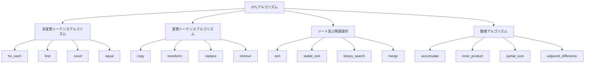

#### 主要アルゴリズムの使用例

```cpp
#include <algorithm>
#include <numeric>
#include <vector>
#include <iostream>

void algorithmExamples() {
    std::vector<int> numbers = {5, 2, 8, 1, 9, 3, 7, 4, 6};
  
    // 非変更アルゴリズム
    auto it = std::find(numbers.begin(), numbers.end(), 3);
    int count = std::count(numbers.begin(), numbers.end(), 2);
  
    // 変更アルゴリズム
    std::vector<int> copied(numbers.size());
    std::copy(numbers.begin(), numbers.end(), copied.begin());
  
    std::transform(numbers.begin(), numbers.end(), numbers.begin(),
                  [](int x) { return x * 2; });
  
    // ソートアルゴリズム
    std::sort(numbers.begin(), numbers.end());
    bool found = std::binary_search(numbers.begin(), numbers.end(), 5);
  
    // 数値アルゴリズム
    int sum = std::accumulate(numbers.begin(), numbers.end(), 0);
  
    std::vector<int> prefixes(numbers.size());
    std::partial_sum(numbers.begin(), numbers.end(), prefixes.begin());
  
    // ラムダ式との組み合わせ
    auto isEven = [](int x) { return x % 2 == 0; };
    int evenCount = std::count_if(numbers.begin(), numbers.end(), isEven);
  
    // 範囲内の全ての要素を処理
    std::for_each(numbers.begin(), numbers.end(), [](int x) {
        std::cout << x << " ";
    });
}
```

### 📍 イテレータの種類と特性

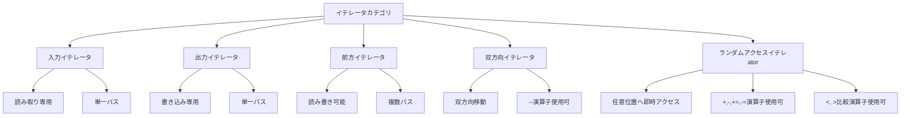

#### イテレータの使用例

```cpp
#include <vector>
#include <list>
#include <iostream>

void iteratorExamples() {
    std::vector<int> vec = {1, 2, 3, 4, 5};
    std::list<std::string> lst = {"apple", "banana", "cherry"};
  
    // 各種イテレータ
    // 前方イテレータ (リスト)
    auto list_it = lst.begin();
    ++list_it; // 前方移動可能
    // --list_it; // 双方向イテレータなら後方移動も可能
  
    // ランダムアクセスイテレータ (ベクター)
    auto vec_it = vec.begin();
    vec_it += 3; // 任意の位置に移動
    int value = vec_it[1]; // 相対位置アクセス
  
    // 逆方向イテレータ
    for (auto rit = vec.rbegin(); rit != vec.rend(); ++rit) {
        std::cout << *rit << " "; // 逆順に表示: 5 4 3 2 1
    }
  
    // constイテレータ (読み取り専用)
    for (auto cit = vec.cbegin(); cit != vec.cend(); ++cit) {
        // *cit = 10; // エラー: 読み取り専用
        std::cout << *cit << " ";
    }
}
```

### 📍 実践的なコンテナ選択ガイド

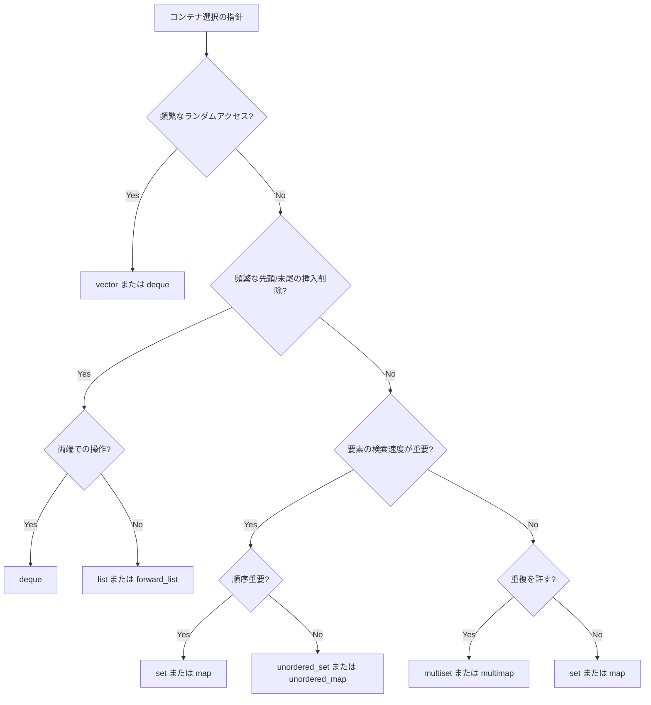

#### コンテナ選択の実例

```cpp
// ケース1: 頻繁なランダムアクセスが必要
std::vector<int> scores(100); // 成績管理システム
for (int i = 0; i < 100; ++i) {
    scores[i] = rand() % 100; // ランダムアクセス
}

// ケース2: 頻繁な先頭/末尾の挿入削除
std::deque<int> transactionLog; // トランザクションログ
transactionLog.push_front(getCurrentTransaction()); // 先頭追加
transactionLog.push_back(getNextTransaction());     // 末尾追加

// ケース3: 頻繁な途中の挿入削除
std::list<int> playlist; // 音楽プレイリスト
auto currentSong = std::next(playlist.begin(), 3);
playlist.insert(currentSong, newSong); // 途中挿入
playlist.erase(currentSong);           // 途中削除

// ケース4: 高速な検索が必要
std::unordered_map<std::string, std::string> config; // 設定値の管理
config["theme"] = "dark";
config["language"] = "ja";
auto it = config.find("theme"); // 高速検索

// ケース5: 順序付きデータ管理
std::set<int> uniqueNumbers; // 重複なしの数値集合
uniqueNumbers.insert(5);
uniqueNumbers.insert(3);
uniqueNumbers.insert(5); // 重複は無視される
// 自動的にソート: {3, 5}
```

## 🎯 学習のポイント

1. **コンテナの特性理解**: 各コンテナの時間計算量と空間計算量を理解する
2. **適切なコンテナ選択**: 用途に応じて最適なコンテナを選択できるようにする
3. **イテレータの適切な使用**: コンテナの種類に応じた適切なイテレータの使用
4. **アルゴリズムとの組み合わせ**: STLアルゴリズムを効果的に活用する

## 🔍 重点的に確認すべき項目

1. **コンテナの時間計算量**:

   - vectorの途中挿入/削除: O(n)
   - listの途中挿入/削除: O(1)
   - set/mapの検索/挿入/削除: O(log n)
   - unordered_set/mapの検索/挿入/削除: 平均O(1), 最悪O(n)
2. **メモリ使用パターン**:

   - vector: 連続メモリ領域
   - list: ノードベース、メモリ分散
   - array: スタックメモリ使用
   - 連想コンテナ: 追加のメモリオーバーヘッドあり
3. **イテレータの無効化**:

   - vectorの挿入/削除で既存イテレータが無効化される可能性
   - listの挿入/削除ではイテレータは無効化されない（削除された要素を除く）

この拡張されたDay 5のカリキュラムで、STLの多様なコンテナとアルゴリズムを深く理解し、実際のコードで適切に使い分けできるようになることを目指しましょう。
