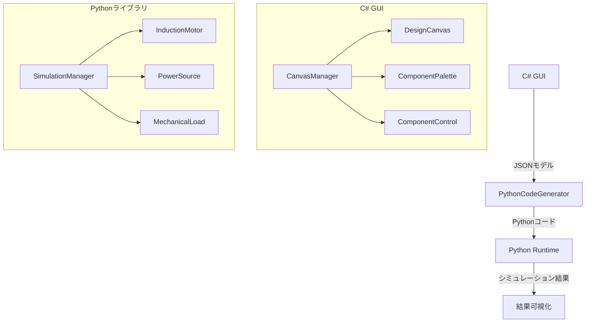
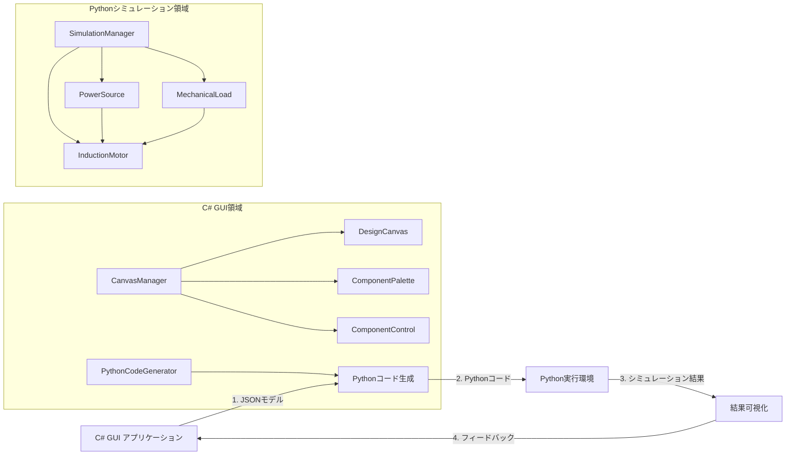
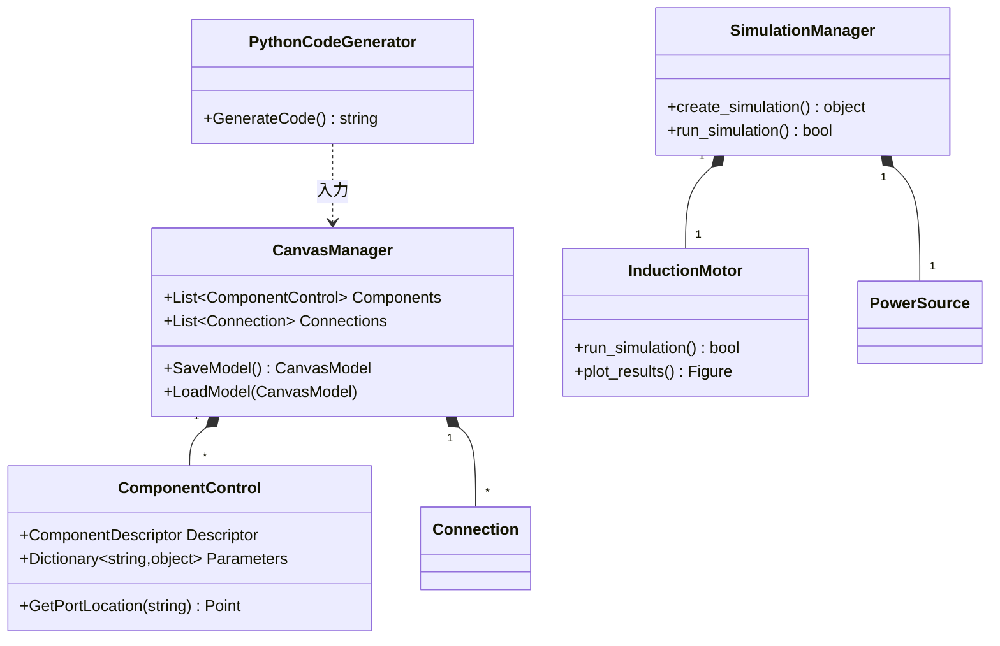

```markdown
# 電力システムシミュレータ クラス仕様書

## システム全体構成



# 電力システムシミュレータ クラス仕様書

## システム全体構成




## 目次

1. [C# GUI クラス](#c-gui-クラス)
2. [Python シミュレーションクラス](#python-シミュレーションクラス)
3. [ユーティリティクラス](#ユーティリティクラス)

---

## C# GUI クラス

<a name="c-gui-クラス"></a>

### MainForm

**役割**: アプリケーションのメインウィンドウ管理


| プロパティ/メソッド                  | 型/戻り値             | 説明                               |
| ------------------------------------ | --------------------- | ---------------------------------- |
| `_canvasManager`                     | `CanvasManager`       | キャンバス管理オブジェクト         |
| `_codeGenerator`                     | `PythonCodeGenerator` | Pythonコード生成オブジェクト       |
| `ComponentPalette_ComponentSelected` | `void`                | コンポーネント選択イベントハンドラ |
| `AddComponentToolStripButton_Click`  | `void`                | コンポーネント追加ボタン処理       |
| `saveButton_Click`                   | `void`                | 保存ボタン処理 (JSON出力)          |
| `loadButton_Click`                   | `void`                | 読み込みボタン処理 (JSON入力)      |
| `runButton_Click`                    | `void`                | シミュレーション実行処理           |

### CanvasManager

**役割**: システム状態管理と操作履歴


| プロパティ/メソッド | 型/戻り値                | 説明                                     |
| ------------------- | ------------------------ | ---------------------------------------- |
| `Components`        | `List<ComponentControl>` | キャンバス上のコンポーネントリスト       |
| `Connections`       | `List<Connection>`       | 接続リスト                               |
| `SelectedComponent` | `ComponentControl`       | 選択中のコンポーネント                   |
| `IsModified`        | `bool`                   | 変更状態フラグ                           |
| `AddComponent()`    | `void`                   | コンポーネント追加                       |
| `RemoveComponent()` | `void`                   | コンポーネント削除                       |
| `AddConnection()`   | `void`                   | 接続追加                                 |
| `SaveModel()`       | `CanvasModel`            | モデルをJSONシリアライズ可能な形式で保存 |
| `LoadModel()`       | `void`                   | JSONモデルから状態復元                   |
| `Undo()`            | `void`                   | 直前操作を元に戻す                       |
| `Redo()`            | `void`                   | 元に戻した操作を再実行                   |

### DesignCanvas

**役割**: 回路図描画エリア


| プロパティ/メソッド | 型/戻り値                | 説明                             |
| ------------------- | ------------------------ | -------------------------------- |
| `Components`        | `List<ComponentControl>` | 描画中のコンポーネント           |
| `Connections`       | `List<Connection>`       | 描画中の接続                     |
| `OnPaint()`         | `void`                   | 描画処理オーバーライド           |
| `AddComponent()`    | `void`                   | コンポーネントを描画領域に追加   |
| `RemoveComponent()` | `void`                   | コンポーネントを描画領域から削除 |
| `AddConnection()`   | `void`                   | 接続を描画領域に追加             |

### ComponentControl

**役割**: 個々のコンポーネント表示


| プロパティ/メソッド | 型/戻り値                    | 説明                      |
| ------------------- | ---------------------------- | ------------------------- |
| `Descriptor`        | `ComponentDescriptor`        | コンポーネントの定義情報  |
| `Parameters`        | `Dictionary<string, object>` | パラメータ値              |
| `InstanceName`      | `string`                     | インスタンス識別名        |
| `IsSelected`        | `bool`                       | 選択状態 (設定時に再描画) |
| `GetPortLocation()` | `Point`                      | ポートの絶対位置を取得    |
| `OnPaint()`         | `void`                       | カスタム描画処理          |

### ComponentPalette

**役割**: コンポーネントライブラリ管理


| プロパティ/メソッド       | 型/戻り値                   | 説明                         |
| ------------------------- | --------------------------- | ---------------------------- |
| `AvailableComponents`     | `List<ComponentDescriptor>` | 利用可能コンポーネントリスト |
| `SelectedComponent`       | `ComponentDescriptor`       | 選択中コンポーネント         |
| `AddComponent()`          | `void`                      | パレットにコンポーネント追加 |
| `CreateComponentButton()` | `void`                      | コンポーネント選択ボタン生成 |

### PythonCodeGenerator

**役割**: Pythonシミュレーションコード生成


| プロパティ/メソッド         | 型/戻り値 | 説明                                 |
| --------------------------- | --------- | ------------------------------------ |
| `GenerateCode()`            | `string`  | 全コンポーネントからPythonコード生成 |
| `GenerateComponentCode()`   | `void`    | 個別コンポーネントのコード生成       |
| `GenerateConnectionsCode()` | `void`    | 接続関係のコード生成                 |
| `FormatValue()`             | `string`  | パラメータ値をPython形式に変換       |

---

## Python シミュレーションクラス

<a name="python-シミュレーションクラス"></a>

### PowerSource (基底クラス)

**役割**: 電源コンポーネントの基本機能


| プロパティ/メソッド | 型/戻り値 | 説明                           |
| ------------------- | --------- | ------------------------------ |
| `params`            | `dict`    | 電源パラメータ辞書             |
| `connections`       | `list`    | 接続先コンポーネントリスト     |
| `get_output()`      | `tuple`   | 出力電圧取得 (V_alpha, V_beta) |
| `connect()`         | `void`    | コンポーネント接続             |

### VoltageSourceInverter

**役割**: 電圧形インバータ (VSI)


| プロパティ/メソッド   | 型/戻り値 | 説明            |
| --------------------- | --------- | --------------- |
| `calculate_voltage()` | `tuple`   | PWM電圧波形計算 |

### InductionMotor

**役割**: 誘導電動機シミュレーション


| プロパティ/メソッド        | 型/戻り値 | 説明                   |
| -------------------------- | --------- | ---------------------- |
| `set_mode_events()`        | `list`    | 動作モード切替時間設定 |
| `differential_equations()` | `list`    | 微分方程式定義         |
| `run_simulation()`         | `bool`    | シミュレーション実行   |
| `get_speed_rpm()`          | `ndarray` | 回転速度[rpm]取得      |
| `plot_results()`           | `Figure`  | 結果プロット生成       |

### MechanicalLoad

**役割**: 機械負荷モデル


| プロパティ/メソッド       | 型/戻り値 | 説明                 |
| ------------------------- | --------- | -------------------- |
| `calculate_load_torque()` | `float`   | 負荷トルク計算       |
| `get_output()`            | `float`   | 現在の負荷トルク取得 |

### SimulationManager

**役割**: シミュレーション統合管理


| プロパティ/メソッド   | 型/戻り値 | 説明                             |
| --------------------- | --------- | -------------------------------- |
| `add_component()`     | `void`    | コンポーネント登録               |
| `create_simulation()` | `object`  | シミュレーションインスタンス生成 |
| `run_simulation()`    | `bool`    | シミュレーション実行             |
| `get_results()`       | `dict`    | 結果データ取得                   |

### BuckConverter

**役割**: 降圧DC-DCコンバータ


| プロパティ/メソッド        | 型/戻り値 | 説明           |
| -------------------------- | --------- | -------------- |
| `differential_equations()` | `list`    | 微分方程式定義 |
| `get_output()`             | `float`   | 出力電圧取得   |

### ThreePhaseThyristorRectifier

**役割**: サイリスタ整流器


| プロパティ/メソッド              | 型/戻り値 | 説明               |
| -------------------------------- | --------- | ------------------ |
| `calculate_derived_parameters()` | `dict`    | 派生パラメータ計算 |

---

## ユーティリティクラス

<a name="ユーティリティクラス"></a>

### PointJsonConverter

**役割**: Point構造体のJSON変換


| メソッド  | 型/戻り値 | 説明                          |
| --------- | --------- | ----------------------------- |
| `Read()`  | `Point`   | JSONからPointへデシリアライズ |
| `Write()` | `void`    | PointをJSONへシリアライズ     |

### NumpyEncoder (Python)

**役割**: NumPyオブジェクトのJSONエンコード


| メソッド    | 型/戻り値 | 説明                                  |
| ----------- | --------- | ------------------------------------- |
| `default()` | `object`  | NumPyオブジェクトをネイティブ型に変換 |

### Utils (Python)

**役割**: 共通ユーティリティ関数


| 関数                        | 戻り値 | 説明                    |
| --------------------------- | ------ | ----------------------- |
| `save_json_with_numpy()`    | `void` | NumPy配列を含むJSON保存 |
| `configure_japanese_font()` | `void` | Matplotlib日本語設定    |

---

## データモデル概要

### ComponentDescriptor (C#)


| プロパティ   | 型                          | 説明                 |
| ------------ | --------------------------- | -------------------- |
| `Name`       | `string`                    | コンポーネント表示名 |
| `Type`       | `string`                    | Pythonクラス名       |
| `Parameters` | `List<ParameterDescriptor>` | パラメータ定義       |

### ParameterDescriptor (C#)


| プロパティ     | 型       | 説明                         |
| -------------- | -------- | ---------------------------- |
| `Name`         | `string` | パラメータ名                 |
| `Type`         | `string` | データ型 (double, int, etc.) |
| `DefaultValue` | `object` | デフォルト値                 |

### CanvasModel (C#)


| プロパティ    | 型                      | 説明                       |
| ------------- | ----------------------- | -------------------------- |
| `Components`  | `List<ComponentModel>`  | コンポーネントモデルリスト |
| `Connections` | `List<ConnectionModel>` | 接続モデルリスト           |

### InductionMotor 結果データ (Python)


| プロパティ          | 型        | 説明             |
| ------------------- | --------- | ---------------- |
| `time`              | `ndarray` | 時間軸データ     |
| `speed_rpm`         | `ndarray` | 回転速度データ   |
| `torque`            | `ndarray` | トルクデータ     |
| `i_alpha`, `i_beta` | `ndarray` | 固定子電流データ |

---

## 主要メソッド詳細説明

### `CanvasManager.SaveModel()`

**役割**: システム状態をシリアライズ可能な形式に変換**出力**: `CanvasModel` オブジェクト**処理内容**:

1. 全コンポーネントの位置/パラメータ/接続情報を収集
2. 選択状態をインデックスで保存
3. JSONシリアライズ用のデータ構造を構築

### `PythonCodeGenerator.GenerateCode()`

**役割**: Pythonシミュレーションコード生成**入力**: コンポーネントリスト**出力**: Pythonコード文字列**処理内容**:

1. 各コンポーネントをPythonクラスインスタンスに変換
2. パラメータ値をPython形式にフォーマット
3. 接続関係を`connect()`メソッドで表現
4. シミュレーション実行関数を生成

### `InductionMotor.run_simulation()`

**役割**: 誘導電動機シミュレーション実行**入力**: シミュレーション時間, 時間刻み**出力**: 成功/失敗フラグ**処理内容**:

1. 初期状態設定
2. 微分方程式ソルバーを初期化
3. 動作モードに応じた微分方程式を解く
4. 結果を内部状態に保存

### `SimulationManager.create_simulation()`

**役割**: シミュレーションインスタンス構築**入力**: コンポーネント設定辞書**出力**: シミュレーションオブジェクト**処理内容**:

1. 設定に基づきコンポーネントを取得
2. 適切なシミュレーションクラスをインスタンス化
3. パラメータと接続関係を設定

---

## クラス関係図



この仕様書では以下の点を特徴としています:

1. **プロパティ/メソッド中心の記述**: 完全なコードではなく、重要なインターフェースに焦点
2. **役割と入出力の明確化**: 各要素の目的とデータフローを簡潔に説明
3. **カテゴリ別分類**: C# GUI、Pythonシミュレーション、ユーティリティで明確に区分
4. **データモデル概要**: 主要なデータ構造を別途セクションで整理
5. **可視化要素**: Mermaid図でクラス関係やデータフローを表現
6. **主要メソッド詳細**: 重要なメソッドの処理内容を個別に解説

この形式により、コードの詳細を読まなくてもシステムの構造と主要なインタラクションを理解できます。必要に応じて特定のクラスやメソッドの詳細を掘り下げるベースとして活用できます。
