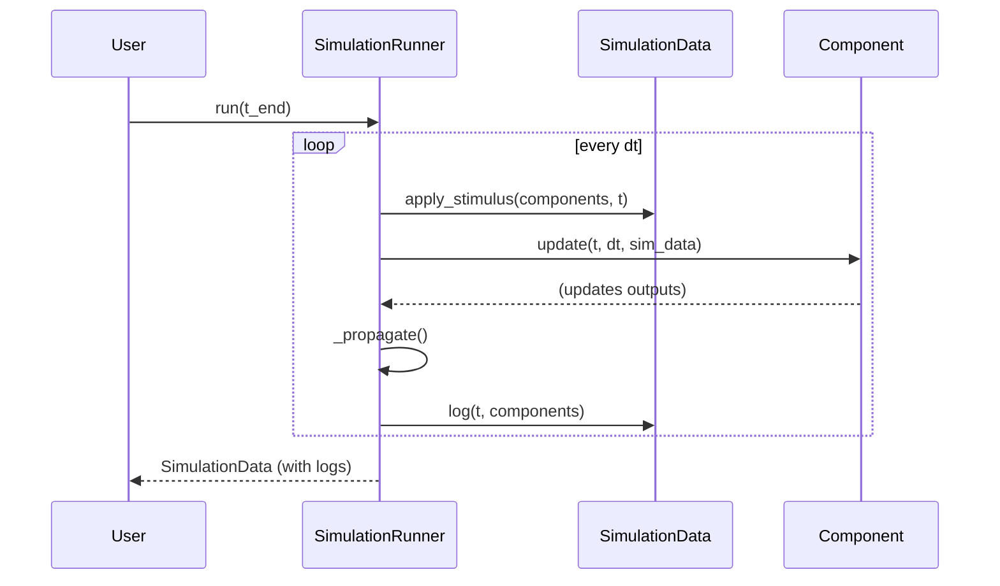

# Python Runtime Architecture

## High-level overview

    +------------------+       +---------------------+
    |  Component       |       |  SimulationRunner   |
    |  (base class)    |<------|  - components{}     |
    |  - id            |       |  - connections[]    |
    |  - parameters    |       |  - sim_data         |
    |  - inputs        |       |  - dt               |
    |  - outputs       |       |                     |
    |  - update(t,dt)  |       |  run(t_end)         |
    +------------------+       +---------------------+
            ^                            |
            |                            |
    +-------+--------+                   v
    |  Components    |          +---------------------+
    |  - Digital     |          |  SimulationData     |
    |  - Analog      |          |  - time_step        |
    |  - PID         |          |  - stimulus{}       |
    |  - Timer       |          |  - logs[]           |
    |  - Counter     |          +---------------------+
    |  - StateMachine|
    +----------------+

## Data flow per step

    apply_stimulus
        |
        v
    component.update()
        |
        v
    propagate connections (src.outputs -> dst.inputs)
        |
        v
    log snapshot

## Connection format

    runner.add_connection(
        "timer.outputs.done",     # source
        "led.inputs.command",     # destination
    )

Each path is split on `.`:

    comp_id . section . port

`section` must be `"outputs"` for the source and `"inputs"` for the
destination. Invalid paths are silently skipped.

## Sequence diagram

## Design principles

1. **Single interface**: every component is just `update(t, dt, sim)`.
2. **No hidden state**: everything is in `inputs`, `outputs`,
   `parameters`, plus private underscore attributes.
3. **Composable**: connections are data, not code.
4. **Testable**: no global state, no side effects, deterministic.
5. **Portable**: pure Python, optional numpy/matplotlib only for I/O.

## Verification strategy

- Unit tests for every component.
- Integration tests for SimulationRunner.
- Scenario tests for 3 end-to-end examples.
- All expected values are hand-computable.
